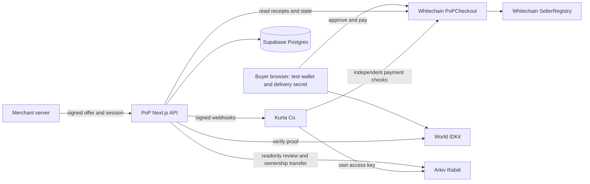

# PoP: Proof of Purchase

**Protected checkout and portable reputation for small sellers.**

Built from scratch at ETHGlobal Mumbai 2026. PoP connects seller-signed purchase commitments, USDT settlement on Whitechain, World ID-gated review eligibility, and public reputation on Arkiv.

> Testnet prototype. Test USDT has no monetary value. The courier is simulated and disputes are decided by a team-operated arbiter. Deadline settlement requires a transaction; withdrawal is separate. The World integration is implemented, but successful official verification is still pending in the recorded evidence.

## Live demonstration

| Application | Link |
|---|---|
| Kurta Co., separate merchant demo | https://kurta-store.vercel.app/ |
| PoP checkout and seller application | https://pop-web-six.vercel.app/ |
| Contracts, transactions, queries, verification log | https://pop-web-six.vercel.app/proof |
| Kurta seller record | https://pop-web-six.vercel.app/verify/kurta.co |
| Public network configuration | https://pop-web-six.vercel.app/api/config |

A final narrated demonstration video is not linked yet. These application links do not replace Whitechain's required submission video.

## The problem and our vision

We started with a familiar question when buying from an unfamiliar seller in India: "Do you offer cash on delivery?"

COD lets buyers wait for a parcel before paying, but sellers bear packing and shipping costs when deliveries are refused. Prepayment shifts risk back to the buyer. Neither method alone establishes product quality, and seller reputation is scattered across social pages and storefronts.

PoP explores a trust layer that participating storefronts, social-commerce sellers, and marketplaces can integrate. Our current implementation is **protected stablecoin prepayment**, not cash collection, rupee settlement, or automatic protection across every platform. Our problem framing comes from the team's experience, not a measured market study.

The wider COD vision requires payment and logistics partnerships, accessible wallets, and stronger dispute operations. We do not claim this prototype eliminates COD fraud.

## Implementation status

| Area | What exists | Evidence boundary |
|---|---|---|
| Whitechain | Verified checkout/registry, specified-USDT payments, releases, refunds, withdrawals | Linked transaction sequences; deployed browser walkthrough needs separate verification |
| Merchant integration | SDK, sessions, signed webhooks, chain rechecks, separate merchant order book | Recorded fork and testnet merchant e2e runs |
| Seller/buyer operations | Onboarding, listings, shipping, disputes, arbiter tools, order CSV | Some full UI flows remain manually unverified |
| Arkiv | Real Rabdi writes, readonly entities, buyer ownership transfer, two application readers | Recorded sample consists of smoke/DEV entities, not eligible World-verified reviews |
| World | IDKit widget, RP signing, server verification, eligibility and uniqueness checks | Successful official proof and observed cancellation journey pending |
| Hosting | Both applications deployed on Vercel | Deployment alone does not establish cron, browser flow, or concurrency correctness |

Historical evidence: [docs/evidence.md](docs/evidence.md), [docs/OVERNIGHT.md](docs/OVERNIGHT.md). Entity expiry and subsequent transactions mean recorded counts are not current adoption metrics.

## Architecture



| Component | Responsibility | Source |
|---|---|---|
| PoPCheckout | Custody, order rules, deadlines, disputes, credit and withdrawal | [Solidity](contracts/src/PoPCheckout.sol) |
| SellerRegistry | Attestor-authorized wallet/handle registration and permanent bans | [Solidity](contracts/src/SellerRegistry.sol) |
| PoP web | Buyer, seller, courier, arbiter, onboarding, proof and API | [application](apps/web/src) |
| Checkout SDK | Offer signing, sessions, webhook verification, chain rechecks | [server](packages/checkout-sdk/src/server.ts), [browser](packages/checkout-sdk/src/browser.ts) |
| Kurta Co. | Separate merchant UI, order book and direct reputation reader | [application](apps/demo-store/src) |
| Shared package | ABIs, networks, hashes, database and Arkiv helpers | [shared](packages/shared/src) |
| Postgres | Encrypted private data and application workflow state | [migration](supabase/migrations/0001_init.sql) |

Whitechain is authoritative for funds and order outcomes. Postgres stores private data, claims and operational state; its order-state column is not the financial authority. Arkiv stores public review records. World supplies human assurance, not purchase or delivery verification.

## Whitechain: deployment and payment evidence

**Whitechain Sepolia: chain ID 1874. Gas: WBT. Payment token: specified USDT, 6 decimals.** We do not substitute a self-minted payment token.

| Contract | Address |
|---|---|
| PoPCheckout | [0xB6A894bE070951a7331DebFf615e11F7a076794c](https://explorer.testnet.whitechain.io/address/0xB6A894bE070951a7331DebFf615e11F7a076794c?tab=contract) |
| SellerRegistry | [0x6D61cD77239dd61e43e943a4Aac006d8A6C285E5](https://explorer.testnet.whitechain.io/address/0x6D61cD77239dd61e43e943a4Aac006d8A6C285E5?tab=contract) |
| Specified test USDT | [0xcedfB56113143d55b2358b8CFbB0dEB5Ad2f55a7](https://explorer.testnet.whitechain.io/address/0xcedfB56113143d55b2358b8CFbB0dEB5Ad2f55a7) |

Both PoP contracts are recorded as verified on Blockscout. Deployment block: **12330545**.

| Recorded example | Transaction |
|---|---|
| Order #1: USDT funding | [pay](https://explorer.testnet.whitechain.io/tx/0xa59f9067bf1d58c716809efe520a0666e4aacbca2dfea4a52b0ad8a79caa5da3) |
| Order #1: delivery confirmation | [confirmDelivery](https://explorer.testnet.whitechain.io/tx/0x2df7522a98d718c38bf7771f48447eb13d2e6fe3e5ba8fb076afbf8968a8c3de) |
| Order #1: seller settlement | [finalize](https://explorer.testnet.whitechain.io/tx/0x38708e796235108faede33d124e92e9777478041de13bec3a1322393e8c51290) |
| Order #1: seller withdrawal | [withdraw](https://explorer.testnet.whitechain.io/tx/0xee21a18433c0a018c24d749faddc6f19f7c58322b55a3c987fe52bddc9b5306a) |
| Order #2: missed-shipping refund | [finalize](https://explorer.testnet.whitechain.io/tx/0xa9d9489ed3094a5497b3ff6982abf3ec7b5ddad3559423a6d3ad696aa28f0278) |
| Order #2: buyer withdrawal | [withdraw](https://explorer.testnet.whitechain.io/tx/0xea25db67fa057553cd95c6915ac60fa04fab48e78b56d1be4fc28dacb403008e) |
| Kurta order #3: merchant checkout payment | [pay](https://explorer.testnet.whitechain.io/tx/0x7bdbd73f594d9bbf0a54f1bf9312e0473fa3622a87deb27c6c0f317e7ef40120) |
| Kurta order #3: release | [finalize](https://explorer.testnet.whitechain.io/tx/0xe924962b6eb53b871b60867d9f81f2c056cdc04606eb27744688db12ac3163d0) |

### Why on-chain stablecoin settlement

PoP uses USDT on Whitechain to bind payment to seller-signed terms and publicly inspectable settlement rules. Eligible deadline refunds can be triggered by anyone without separate seller or PoP approval. Merchants independently verify payment and settlement events. Conventional rails could offer similar buyer protection, but would require the processor/platform to implement and authorize those outcomes; they do not expose this contract's independently callable settlement mechanism. Whitechain's EVM compatibility allows standard Solidity, token tooling, and wallet clients.

## Smart contract implementation

```text
Funded -> Shipped -> Delivered -> Released
   |         |          |
   |         |          +-> Disputed -> Released / Refunded / Split
   |         +-> late delivery -> Refunded
   +-> late shipping -> Refunded
Disputed -> arbitration timeout -> Refunded
```

### Signed offers and seller registration

EIP-712 offers bind `seller`, `listingId`, `termsHash`, `externalRef`, `price`, `shipWithin`, `deliverWithin`, `maxUnits`, `validUntil`, and `version`. The signing domain binds chain and checkout deployment. Terms are recursively key-sorted canonical JSON before hashing. `externalRef` is the hash of a website cart reference.

Payment rejects inactive sellers, invalid signatures, expired/revoked offers, exhausted stock, and same-wallet self-purchases. Offer digests track units sold; sellers can revoke lower versions. Merchant checkout sessions require `maxUnits = 1`.

Registry registration requires an expiring attestor signature and prevents signature reuse and conflicting handle ownership. Tier 1 means a manual bio-code check; cryptographic tier 2 is reserved, not an implemented Reclaim integration. Bans cover both the registered wallet and handle.

### Delivery and deadlines

The buyer's browser generates six random words from the BIP-39 English wordlist using Web Crypto (66 bits). The words are the secret, not a wallet seed. Only this hash is committed at payment:

```text
keccak256(abi.encodePacked(chainId, checkoutAddress, normalizedCodeBytes))
```

The app normalizes lowercase words and spaces. Anyone with the code can call `confirmDelivery`; the buyer can call `confirmReceived` directly. Both start a dispute window. Code possession is an acknowledgment mechanism, not independent proof of parcel contents. Submitted code bytes become public transaction input.

`markShipped` is seller-only and must meet `shipBy`; it starts `deliverBy`. Anyone can call `finalize` after the applicable deadline/window: still-Funded and still-Shipped orders refund, Delivered orders release, and timed-out Disputed orders refund. Finalization requires time strictly after the relevant deadline.

**Late confirmation:** the current confirmation functions do not reject calls after `deliverBy`. A valid buyer/code confirmation can precede refund finalization and move a still-Shipped order to Delivered. Deadline expiry alone does not irrevocably select the refund outcome.

### Disputes and accounting

The courier role can report handover refusal before the delivery deadline, changing Shipped to Disputed without paying anyone. A buyer can dispute Delivered orders within the window. The arbiter allocates basis points to the buyer: full refund, seller release, or split. Buyer allocation above 50% increments lost disputes.

Settlement moves locked value into recipient credits. `withdraw` and permissionless `withdrawFor(account)` transfer credit to its owner; a caller cannot redirect it. SafeERC20 and reentrancy guards protect payment operations. Solvency requires token balance to cover `totalLocked + totalCredit`; unsolicited transfers can create surplus.

Deployment-script defaults: 1% fee on the seller portion, 30-second trusted / 120-second default dispute windows, three completed orders for trust, and 300-second arbiter timeout. Verify deployed values before relying on defaults. A seller needs zero lost disputes for the short window; the window is captured at delivery. Demo times are not appropriate production settings.

`forceRefundBanned` permits arbiter-only full buyer refunds for Funded, Shipped, or Disputed orders of an inactive seller. Delivered and terminal orders are excluded.

## Merchant SDK and integration

The SDK is a **private workspace package**, not a published npm release. Kurta is a separate application in this monorepo. External users must package/vendor the SDK and shared dependency or adapt the HTTP integration.

Prerequisites: registered seller wallet, merchant API key, webhook secret, configured webhook URL and allowed return origin, server-side signing key, and an idempotent merchant order store. The demo provisioning path is [seed-merchant.ts](scripts/seed-merchant.ts); public self-service credential issuance is not claimed.

### Minimal checkout integration

This short integration excludes credential provisioning and your existing cart/order storage:

```ts
import { PoP } from "@pop/checkout-sdk/server";
import type { Hex } from "viem";

const pop = new PoP({
  baseUrl: "https://pop-web-six.vercel.app",
  apiKey: process.env.POP_API_KEY!,
  webhookSecret: process.env.POP_WEBHOOK_SECRET!,
  merchantPk: process.env.MERCHANT_PK! as Hex,
  chain: {
    id: 1874,
    rpcUrl: "https://rpc.testnet.whitechain.io",
    checkout: "0xB6A894bE070951a7331DebFf615e11F7a076794c",
  },
});
const session = await pop.createSession({
  title: "Hand-block cotton kurta", priceInr: 1299, priceUsdt: "1.50",
  merchantRef: "your-cart-id", returnUrl: "https://your-store.example/orders",
});
// Your POST /api/checkout returns { url: session.url }.
```

```ts
import { startPayWithPoP } from "@pop/checkout-sdk/browser";
await startPayWithPoP("/api/checkout");
```

The merchant signs offers locally; PoP does not receive its private key. The session API verifies Bearer credentials, offer signature, seller/session/reference binding, stock, expiry, and allowed return origin. INR prices are display metadata, not an exchange-rate service.

### Webhooks and independent verification

```ts
// Server-side receiver, using the configured pop instance:
const raw = await request.text();
const event = pop.verifyWebhook(raw, request.headers.get("pop-signature"));
const result = await pop.confirmOnChain(event);
// Persist event/result idempotently before acknowledging HTTP 2xx.
```

See the [actual receiver](apps/demo-store/src/app/api/pop/webhook/route.ts).

Signature: `PoP-Signature: t=<unix>,v1=<HMAC-SHA256 of "t.rawBody">`. Verification uses constant-time comparison and a default 300-second timestamp tolerance. The SDK checks chain/checkout, merchant ownership, buyer, amount, compatible state, successful funding receipt, and `keccak(merchantRef)` in the event.

Supported events: `order.funded`, `order.shipped`, `order.delivered`, `order.released`, `order.refunded`. Dispute/split notifications are not implemented. Event IDs should be scoped to chain and deployment.

The dispatcher stores a block cursor, scans bounded ranges, enqueues idempotently, and claims rows with database locking and a lease. Delivery is **at least once**, with up to eight attempts; receivers must deduplicate. Vercel cron configuration requests a pass every minute; order APIs and a local loop are additional triggers. Scheduled execution and concurrent dispatch require runtime validation. No finalized-block/reorganization guarantee is claimed.

The CSV provides order states, amounts, references, timestamps, and transaction hashes for up to 500 orders. It is not full fee/net/withdrawal reconciliation. Partial refunds are arbiter decisions, not a merchant one-click refund API.

## Arkiv: portable review records

Network: **Rabdi, chain 7794095**. SDK: `@arkiv-network/sdk` 1.0.1, server-side.

Writer/attestor wallet: **`0xeF0CC7f7f280083e425A741957B920c7eF39A21c`**.

Only `pop_review_v1` is written. Seller/outcome schemas are planned names, not shipped features.

| Property | Implementation |
|---|---|
| Indexed | seller, order_id, rating, created_at, reviewer_key, buyer_history |
| Other fields | pay_tx, text, buyer_sig |
| Creator | PoP attestor |
| Owner | Attestor creates, then transfers to buyer |
| Flags | readonly; permissionless extension disabled |
| Lifetime | 180 days normally; 24 hours for DEV entries |
| Text | Up to 500 normalized characters |

Readers check trusted creator, readonly status, and matching payment transaction on the selected checkout. DEV entries do not count toward verified ratings. The public reviewer key is `keccak(nullifier, seller)`; only a hash of the nullifier is persisted privately. Buyer-history buckets count registered wallet orders, not unique humans or only completed orders.

### Why Arkiv instead of only Postgres

Kurta queries the public records with its own key, without calling PoP's verification API. Creator metadata and readonly records make provenance and content mutability inspectable independently of our database. With configured chain pins and attestor, existing reputation can be read while PoP is unavailable. New hosted checkout still needs PoP.

PoP can refuse initial publication. Ownership is not perpetual availability: entities expire. Readers trust the attestor's eligibility checks; the entity does not independently prove World verification on-chain. Public wallet reuse can link activity. Our second app demonstrates portability, not external adoption.

### Runnable read-only query

After installing repo dependencies, save the following in a workspace `.ts` file and run `npx tsx <file>`. Supply your own [Arkiv access key](https://hub.arkiv.network/access-keys) as `ARKIV_ACCESS_KEY`. No signing key is required:

```ts
import { createPublicClient, http } from "@arkiv-network/sdk";
import { rabdi } from "@arkiv-network/sdk/chains";
import { ReviewSchema } from "@pop/shared/server/arkiv";

const accessKey = process.env.ARKIV_ACCESS_KEY;
if (!accessKey) throw new Error("Set ARKIV_ACCESS_KEY");
const client = createPublicClient({ chain: rabdi({ accessKey }), transport: http() });
const page = await client
  .select({ $key: true, $owner: true, $creator: true, $creationFlags: true,
    seller: true, order_id: true, rating: true, reviewer_key: true, pay_tx: true })
  .from(ReviewSchema)
  .createdBy("0xeF0CC7f7f280083e425A741957B920c7eF39A21c")
  .limit(25)
  .fetch();
console.log(page.entities.filter((e) => e.$creationFlags?.readonly));
```

This prints raw provenance records, not a fully validated seller rating. Product readers additionally reject DEV and unmatched payments. Entities may expire between runs.

Existing operator command: `npx tsx scripts/arkiv-query.ts`. It derives the writer from configured `ATTESTOR_PK`; use the public-address example above when you do not possess our signing key. `npx tsx scripts/arkiv-query.ts KURTA_ARKIV_ACCESS_KEY` reads the separate key from `apps/demo-store/.env.local`.

Required judging documents: [schema](arkiv/schema.md), [friction](arkiv/friction.md), [reach](arkiv/reach.md), [why Arkiv](arkiv/why-arkiv.md), [how we use it](arkiv/how-you-use-arkiv.md).

## World IDKit: review eligibility

**Trust moment:** publishing a review after an order is Released. World never gates payment, settlement, or refunds.

**Minimum assurance:** `proofOfHuman`. We need human uniqueness, not legal identity or a passport. Buyer signatures establish authorization; the contract establishes an eligible purchase; World provides human assurance. None proves seller honesty or product quality.

The frontend uses `IDKitRequestWidget` with signed RP context. The backend checks environment, seller action, and signal `keccak256(abi.encodePacked(orderId, buyerAddress))`, then verifies through the configured World endpoint. It also checks Released state, seller match, and buyer signature over rating/text.

A transaction claims `UNIQUE(nullifier_hash, seller_wallet)` plus a unique review per order. Publication failures retry the accepted row without another claim. The policy is **one review per human per seller**, with one review per order. Refunded/Split orders cannot review. Each configured seller has a pre-created World action; arbitrary onboarding does not automatically provision one.

### Verification status and failure paths

- RP signing and invalid-proof rejection probes are recorded.
- Successful official simulator verification and observed cancellation remain pending in [WORLD_DEBRIEF.md](docs/WORLD_DEBRIEF.md).
- Required demonstration: valid proof -> backend success -> Arkiv publication; cancel/reject -> no publication; same human on another eligible order for the same seller -> refusal.
- Simulator/staging identities are not production proof-of-human evidence.
- `POP_DEV_SKIP_WORLD=1` is local-only, produces DEV records and fails closed on deployed builds. It is not a successful sponsor verification.

The [debrief](docs/WORLD_DEBRIEF.md) records integration timing, friction, action-scoping constraints and improvement requests. [Operator steps](docs/OVERNIGHT.md) describe the prepared simulator workflow. This project uses IDKit, not Agent Pass.

## Trust model and limitations

| Actor | Authority |
|---|---|
| Buyer | Fund, confirm receipt, dispute within window, withdraw credit |
| Seller | Sign/revoke offers, ship, withdraw credit |
| Code holder | Confirm delivery of a Shipped order, not select payout recipients |
| Courier role | Open pre-deadline handover-refusal dispute, not settle funds |
| Arbiter | Resolve disputes, ban, invoke qualifying banned-seller refunds |
| Admin | Grant/revoke roles and appoint arbiters; no arbitrary direct fund sweep |
| Attestor | Authorize registration and publish reviews; can withhold publication |
| Anyone | Trigger eligible finalize/withdrawFor, not redirect recipients |

- Contracts are not externally audited. The team arbiter/admin remain substantial trust assumptions.
- Delivery code is not an independent logistics oracle.
- No autonomous settlement service: browser auto-settle needs an active page. Webhook cron only reports events.
- Browser localStorage test wallets and pasted operator keys are unsuitable for real funds.
- Sellers can use additional wallets/colluding humans. Completed orders are not distinct-customer counts and affect dispute-window eligibility.
- Delivery details are AES-256-GCM encrypted in Postgres, but PoP holds the key. Current database TLS disables certificate verification and needs hardening.
- Payments, buyer wallets, timings, entity ownership and submitted codes are public. Do not include personal information in review text.
- Review writing is serialized in one process only; serverless cross-instance nonce safety needs further work.
- Rate limits, bounded event/query readers, reorganizations, concurrent claims, real phones and human accessibility testing need further validation.
- Readers are scoped to the configured checkout; redeployment can exclude prior history. No history migration guarantee exists.

See [limitations](docs/limitations.md). Historical operator documents may still say hosting is pending; live links here supersede that statement, not their unverified runtime assumptions.

## Repository and routes

```text
apps/web/                 PoP Next.js app and API
apps/demo-store/          Separate merchant application
packages/shared/         Types, ABIs, networks, data/hash helpers
packages/checkout-sdk/   Server/browser merchant SDK
contracts/               Solidity, Foundry tests and deploy script
scripts/                 Fork, migration, seed, query and e2e tooling
supabase/migrations/     Application database schema
arkiv/                   Sponsor judging documents
docs/                    Evidence, deployment, demo and limitations
specs/                   Planning and agent prompt
```

Routes: `/p/[listingId]`, `/o/[orderId]`, `/dashboard`, `/onboard`, `/courier`, `/arbiter`, `/verify/[handle]`, `/proof`, `/dev/world`. Team tools require credentials; do not publish credentials for judging.

Merchant API: `POST /api/v1/checkout-sessions`, `GET /api/v1/checkout-sessions/[id]`. See [all API routes](apps/web/src/app/api). `GET /api/webhooks/dispatch` performs outbound work; it is not a passive health check.

## Setup and configuration

### Prerequisites

Node compatible with Next.js 16 (repo recommendation: Node 22+), npm workspaces, Git/submodules, Foundry, Supabase Postgres, test-only role wallets, and provider credentials. Recorded Windows Foundry commands use Git Bash.

```bash
 git clone https://github.com/Dhruva-0206/pop.git
 cd pop
 git submodule update --init --recursive
 npm ci
 cp .env.example .env
```

Fill `.env` locally. Never commit it or put secrets in `NEXT_PUBLIC_*`. Do not run `npm run wallets` on the team's existing configuration: it overwrites wallet values. Fresh operators must deliberately provision their own test keys.

| Group | Variables |
|---|---|
| Network | `NETWORK_MODE`, `WHITECHAIN_RPC_URL`, `FORK_RPC_URL`, `USDT_ADDRESS` |
| Deployment | Local `deployments/<mode>.json` or `CHECKOUT_ADDRESS`, `REGISTRY_ADDRESS`, `DEPLOY_BLOCK` |
| Private data/auth | `DATABASE_URL`, `ADDRESS_ENC_KEY` (32 bytes base64), `SESSION_SECRET`, `COURIER_PASSCODE` |
| PoP server role secrets | `ATTESTOR_PK`, `COURIER_PK`, `FAUCET_PK` |
| Operator/scripts | `DEPLOYER_PK`, `ARBITER_PK`, `TEST_BUYER_PK`, `SELLER_PK`, `MERCHANT_PK` as needed |
| Arkiv | `ARKIV_ACCESS_KEY`; attestor needs Rabdi test gas |
| World | `WORLD_APP_ID`, `WORLD_RP_ID`, `WORLD_RP_SIGNING_KEY`, `WORLD_ENVIRONMENT`; optional `WORLD_REVIEW_ACTIONS` |
| PoP origin | `NEXT_PUBLIC_BASE_URL` |
| Kurta server | `POP_BASE_URL`, `KURTA_ORIGIN`, `POP_API_KEY`, `POP_WEBHOOK_SECRET`, `MERCHANT_PK`, `DATABASE_URL`, `KURTA_ARKIV_ACCESS_KEY`, `POP_ATTESTOR_ADDRESS` |
| Kurta independent chain pin | `CHAIN_ID`, `RPC_URL`, `CHECKOUT_ADDRESS`, `REGISTRY_ADDRESS`, `DEPLOY_BLOCK` |

Deployer and arbiter keys stay off the hosted PoP server. `NEXT_PUBLIC_WORLD_APP_ID` is unused by the current flow; widget config comes from the server. Reclaim placeholders in `.env.example` do not represent an implemented integration.

### Local fork

With `NETWORK_MODE=fork` in root `.env`, start these terminals from the repo root:

```bash
# Terminal 1
npm run fork
```

```bash
# Terminal 2
npm run fork:up
npm run seed:merchant
npm run dev:web
```

```bash
# Terminal 3
npm run dev -w @pop/demo-store
```

PoP: `http://localhost:3000`. Kurta: `http://localhost:3001`. PoP's Next config explicitly loads root `.env` locally; scripts also load it. Merchant seed writes app-local configuration; add its separate Arkiv key and verify settings. Avoid stale testnet address overrides when using a fresh fork.

The local fork uses chain ID **31337** to prevent replay of its transactions against testnet. Token funding writes local proxy storage; it is not a real Whitechain payment. After a fork restart, the operator may run `npm run db:reset-fork` before `fork:up`: this deliberately drops/recreates the `pop_fork` schema. Do not treat it as a general database reset.

Postgres uses `public` for testnet and `pop_fork` for local fork; no JSON fallback. `npm run db:migrate` applies/upgrades the schema. Seeds and e2e scripts mutate data and can send transactions. Inspect mode before running them.

### Testnet and Vercel

Use the documented deployment unless intentionally creating a separate instance. WBT pays gas; the recorded team obtained specified USDT via YetiTrade. Do not assume the WBT faucet distributes this USDT.

For Git Bash shell exports, source the environment before selecting mode:

```bash
set -a
source ./.env
set +a
unset POP_DEV_SKIP_WORLD
export NETWORK_MODE=testnet
npm run dev:web
```

Set matching addresses/block if environment overrides are used. Demo windows use real time; there is no testnet time-warp button.

Vercel hosts the apps as separate projects with workspace-source inclusion. Configure each project's variables, merchant public webhook/return URLs, and chain pins. Never enable the World bypass on Vercel. The configured every-minute cron requires a compatible hosting plan. Full variable lists, smoke commands, and runtime caveats: [deployment guide](docs/deployment.md). Its old pre-deployment narrative is historical.

## Validation

Recorded results, not a claim of a fresh run on this documentation change:

| Check | Result recorded |
|---|---|
| Foundry | 58 passing tests, including unit/fuzz and suite with six invariants |
| Fork application e2e | 65 passing checks |
| Fork merchant e2e | 48 passing checks |
| Later Whitechain merchant e2e | 47 passing checks |
| UI | Nine pages recorded at Lighthouse accessibility 100; not human accessibility certification |

Sources: [overnight log](docs/OVERNIGHT.md), [evidence](docs/evidence.md), [tests](contracts/test), [fork e2e](scripts/e2e-fork.ts), [merchant e2e](scripts/e2e-merchant.ts). Earlier totals are historical runs, not current aggregate results.

```bash
# From contracts/, Git Bash on Windows
forge build
forge test

# From repo root
npm run build
npm run lint -w @pop/web
npm run lint -w @pop/demo-store
npm run typecheck:shared

# Stateful: require configured servers, DB and test chain
npx tsx scripts/e2e-fork.ts
npm run e2e:merchant
```

For local review pipeline testing only, export `POP_DEV_SKIP_WORLD=1` in the shell of local `next dev`. This skips World, not Arkiv: tests can still publish real Rabdi DEV entities and consume test gas. The bypass is forbidden on deployed builds.

### End-to-end demonstration checklist

1. Kurta creates session; buyer pays specified USDT.
2. Merchant receives signed webhook and independently checks the chain.
3. Seller ships; buyer/code confirms; finalize after window and withdraw.
4. Another account finalizes an expired order; buyer withdraws refund.
5. Wrong code or forged webhook is rejected.
6. Official World proof permits review; cancellation/rejection publishes nothing.
7. Same human is refused on another eligible order for the same seller.
8. Both apps read the eligible Arkiv review; show entity key, creator, owner, flags, payment and expiry.

The official-proof steps remain outstanding in recorded evidence. Label prepared scenes and simulations. [Demo script](docs/demo-script.md) needs rehearsal. Whitechain's video must be 2-4 minutes, show the involved parties, and satisfy event recording rules (720p+, human narration, no sped-up footage or AI voiceover).

## Sponsor evidence map

| Target | Integration | Evidence / outstanding work |
|---|---|---|
| Whitechain Operate | Reusable merchant checkout, specified USDT, verified contracts, lifecycle, refunds and CSV | Links above, [feedback](WHITECHAIN_FEEDBACK.md); final video and full deployed browser validation still to document |
| Arkiv Build on Arkiv, from scratch | Real writes and visible reads, readonly records, ownership/expiry, separate reader | Writer/query and [judging files](arkiv/); eligible non-DEV cross-app review demonstration pending |
| World Best Use of IDKit | Review trust gate, proportional credential, backend checks | [debrief](docs/WORLD_DEBRIEF.md); official success and observed alternative path pending |

No prize qualification or placement is guaranteed. We do not claim Agent Pass, Swarm, gasless Scale, or tokenized-asset functionality.

## AI use, provenance and dependencies

[AI_USAGE.md](AI_USAGE.md) discloses AI-assisted planning, code, docs and visuals, with recorded human decisions/review status. [Specs and prompt](specs/) are retained for the spec-driven workflow. The team must resolve outstanding provenance/organizer questions and complete human review; this README is not an organizer eligibility ruling.

Built with Next.js/React, Solidity, Foundry/forge-std, OpenZeppelin Contracts, viem, Arkiv SDK, World IDKit, PostgreSQL/pg and Supabase, Tailwind, zod, qrcode/html5-qrcode, @scure/bip39, dotenv, and Figtree/IBM Plex Mono fonts. Versions are recorded in manifests, lockfiles and submodules. Public libraries and starter tooling are reused dependencies, not original PoP inventions.

Buyer protection and review systems have substantial prior art. Our prototype combines merchant-verifiable protected settlement with independently readable reputation across two commerce applications; no exhaustive novelty or external-adoption claim is made.

## License

[MIT](LICENSE). Dependencies, fonts and submodules retain their respective licenses.
