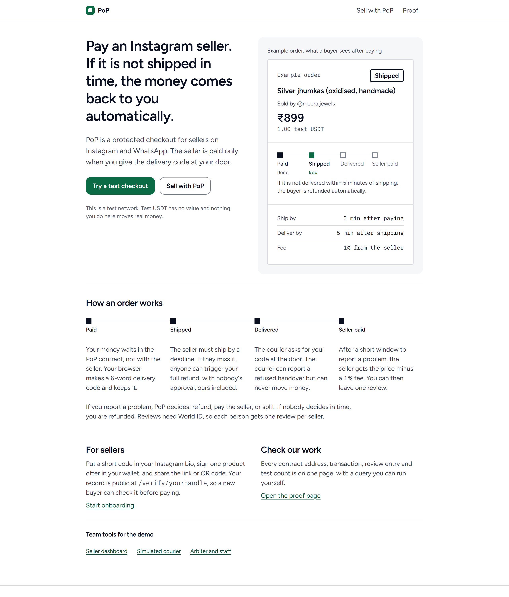
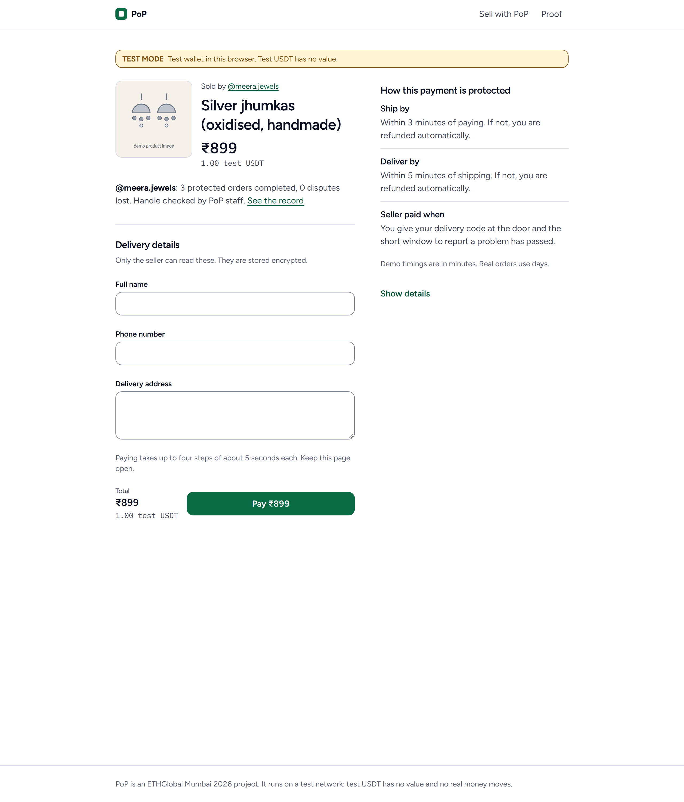
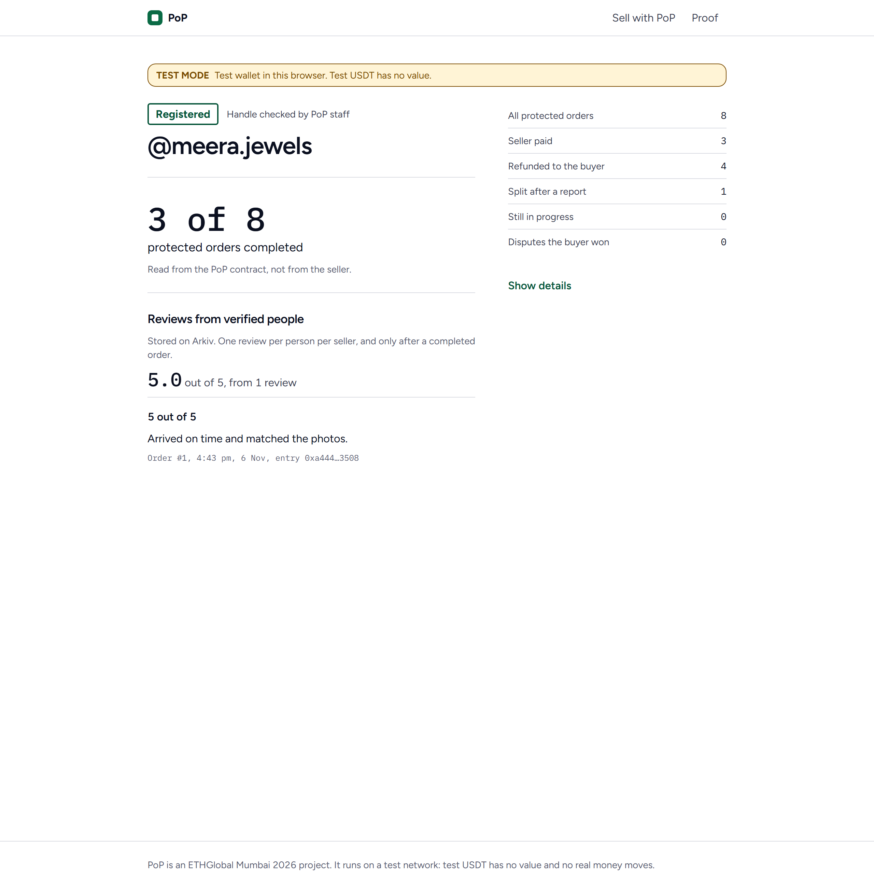
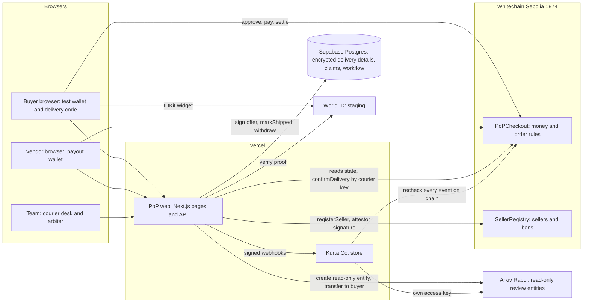
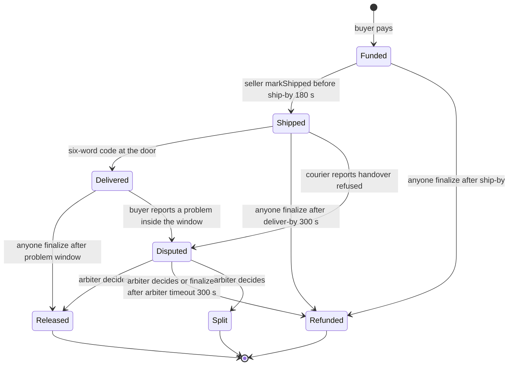
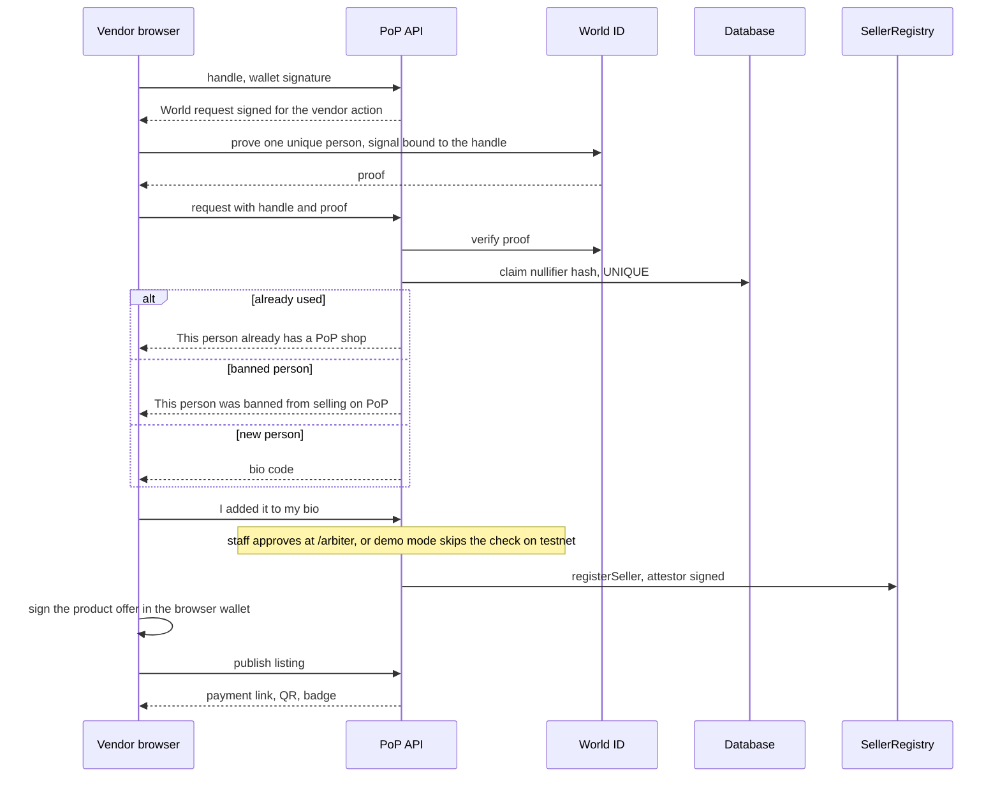
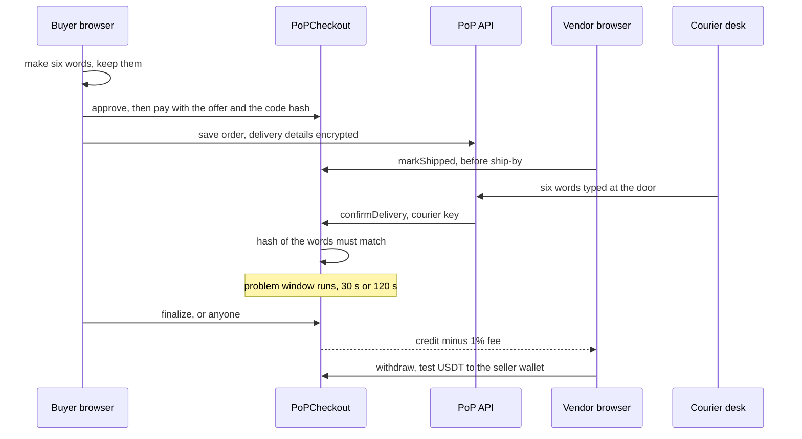
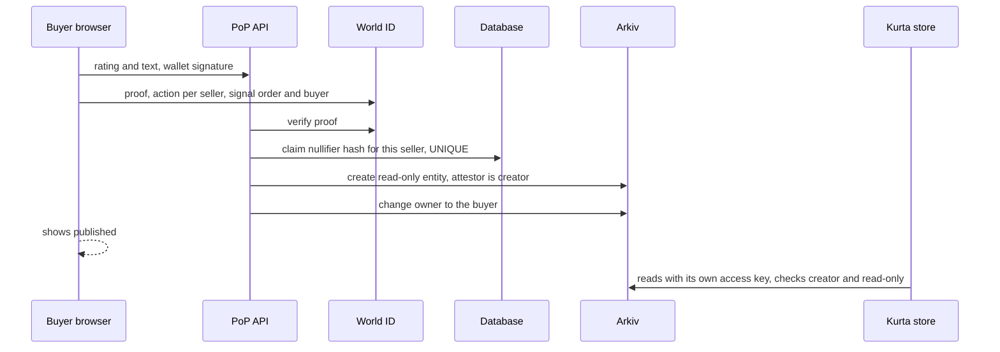

<h1 align="center">PoP: Proof of Purchase</h1>

<strong>Checkout is the easy part. PoP handles what happens after.</strong>

No parcel, no payout. Late means refunded. No review without a receipt.

A USDT checkout for sellers on Instagram, WhatsApp, Facebook and small websites. The payment comes back to the buyer automatically if the parcel is late, and it is paid out when the buyer's own code is entered at the door.

Built from scratch at ETHGlobal Mumbai 2026 (Whitechain, Arkiv and World prize tracks).

1. **"If it doesn't arrive, you get your money back automatically. Nobody can stop that refund, including us."** Anyone can trigger the refund after a missed deadline, and it can only go to the buyer. (One honest exception is listed under [limits](#8-honest-limits).)
2. **"The money is released by the buyer's code at the door; our courier key can't release a single rupee."** The courier can only report a refused handover. Only the contract decides what happens to the money.
3. **"Reputation is earned only from protected deliveries, counts each human once per seller, and lives on Arkiv where any app can read it."** A review needs a paid and delivered order, a World ID proof, and is stored as a read-only Arkiv entity owned by the buyer.

> **Test network only.** Test USDT has no value. The courier is simulated, a team arbiter decides disputes, and World ID runs in its staging environment with the Simulator. Details in [honest limits](#8-honest-limits).

## 2. Live links and how to verify us in 2 minutes

| What | Link |
|---|---|
| PoP (checkout, vendors, tools) | https://pop-web-six.vercel.app |
| Kurta Co., a second shop that sells through PoP | https://kurta-store.vercel.app |
| **Proof page**: contracts, every order with transaction links, Arkiv entities, World log, test counts | https://pop-web-six.vercel.app/proof |
| Seller records | [/verify/meera.jewels](https://pop-web-six.vercel.app/verify/meera.jewels), [/verify/kurta.co](https://pop-web-six.vercel.app/verify/kurta.co) |

**Whitechain Sepolia, chain 1874** (both contracts verified on Blockscout, deployed in block 12330545):

| Contract | Address |
|---|---|
| PoPCheckout | [`0xB6A894bE070951a7331DebFf615e11F7a076794c`](https://explorer.testnet.whitechain.io/address/0xB6A894bE070951a7331DebFf615e11F7a076794c?tab=contract) |
| SellerRegistry | [`0x6D61cD77239dd61e43e943a4Aac006d8A6C285E5`](https://explorer.testnet.whitechain.io/address/0x6D61cD77239dd61e43e943a4Aac006d8A6C285E5?tab=contract) |
| Specified test USDT (6 decimals) | [`0xcedfB56113143d55b2358b8CFbB0dEB5Ad2f55a7`](https://explorer.testnet.whitechain.io/address/0xcedfB56113143d55b2358b8CFbB0dEB5Ad2f55a7) |

> **Verify in 2 minutes**
> 1. Open [/proof](https://pop-web-six.vercel.app/proof). It reads the contract live: the order table has a transaction link for every step of every order. As last read on Sat 7 Nov: 25 orders (13 released, 9 refunded, 1 split, 2 still open).
> 2. Open any order's `pay` link in Blockscout, then the contract tab: the source is verified.
> 3. In the same table find a **Refunded** order whose settle transaction was sent by a third party (order 2, `finalize`), then the buyer's `withdraw`.
> 4. Open the Arkiv table on `/proof`: two **regular** review entities (orders 1 and 18), creator = our attestor, read-only, owner = the buyer. The other entries are labelled DEV or smoke test.
> 5. Run the read-only query yourself: `npx tsx scripts/arkiv-query.ts` (needs an [Arkiv access key](https://hub.arkiv.network/access-keys)), or use the snippet in [arkiv/how-you-use-arkiv.md](arkiv/how-you-use-arkiv.md).
> 6. Check the refusals: [/verify/bad.bazaar](https://pop-web-six.vercel.app/verify/bad.bazaar) is a banned seller, [/verify/meera.jewels.official](https://pop-web-six.vercel.app/verify/meera.jewels.official) is an unregistered look-alike.

Screenshots of the public pages from the evening of 6 Nov. The landing page wording has changed since; no keys, passcodes or wallets are on screen.

| Landing | Checkout | Seller record |
|---|---|---|
|  |  |  |

## 3. The problem and who it is for

A lot of small Indian sellers live on Instagram, WhatsApp, Facebook and small websites. A buyer who has never heard of the shop asks the familiar question: "Do you do cash on delivery?" Cash on delivery lets the buyer wait for the parcel before paying, but the seller carries the cost when parcels are refused. Paying first flips the risk onto the buyer, and a shop's reputation is scattered across posts and comments that anyone can fake or delete.

PoP is a protected prepayment for these sellers. The buyer pays into a contract, not to the seller. If the seller does not ship in time, or the parcel is not delivered in time, the buyer gets the full amount back and nobody has to approve it. The seller is paid when the buyer types a six-word code at the door. Reviews can only come from orders that went through this flow.

Our problem framing comes from the team's own experience, not a market study. What exists today is protected stablecoin prepayment on a test network, not cash handling, rupee settlement or protection across every platform.

## 4. How it works

**For a buyer** (no crypto knowledge needed, the page creates a test wallet in the browser)
1. Open a shop's link or QR (`/p/<name>`). Before paying you see the seller's record, the refund deadlines and the price in rupees and test USDT.
2. Press Pay. In about 15 seconds the page adds test funds, allows the exact amount, pays, and saves your delivery details (stored encrypted).
3. The order page shows the countdown and **your delivery code, six words**. Only a hash of it goes on chain. Screenshot it.
4. The seller ships, the courier asks for the code at the door, the code is entered, and after a short window the seller is paid (1% fee). If anything goes wrong in time, **Settle** refunds you.
5. After the seller is paid you can leave one review, using World ID.

**For a vendor** (`/onboard`; in demo mode, registering and publishing took about 7 seconds after the World check when we rehearsed it)
1. Type the Instagram handle (and the first product's name and price).
2. **World ID check**: a proof that you are one unique person, bound to the handle. One person can open one shop. It does not prove who you are.
3. PoP shows a **bio code** (`POP-` plus six characters). You press "I added it to my bio". With staff approval a team member checks the bio first; in demo mode on testnet that check is skipped and the page says so.
4. The shop is registered on chain, your product offer is signed in your browser wallet, and you get a **payment link, QR and a badge snippet**.
5. At `/dashboard`, in the same browser, you mark orders shipped and withdraw your money. The payout wallet is created in that browser.

**The simulated courier desk** (`/courier`, team passcode): a team member types the buyer's six words for a shipped order. The contract checks the words, not the courier. The courier can also report "handover refused", which only opens a dispute.

**The arbiter** (`/arbiter`): resolves disputes (refund, release or split), bans sellers, and can refund open orders of a banned seller in full.

## 5. Architecture

### a. System

### b. Order state machine

The problem window is **30 s for a seller with at least 3 completed orders and no lost disputes, otherwise 120 s**. An arbiter decision emits `DisputeResolved` and ends in Released, Refunded or Split. Separately, the arbiter can force a full refund of an open order (Funded, Shipped or Disputed) of a banned seller.

### c. Vendor onboarding

### d. Buyer pays, ship, courier code, release

### e. Review with World ID and the Arkiv entity

## 6. Contract design

Solidity 0.8.30 (Prague EVM), OpenZeppelin v5, tested with Foundry. Source: [`contracts/src`](contracts/src).

| Item | Value (read from the deployed contract) |
|---|---|
| Fee | 100 basis points (1%), taken from the seller's share, paid to the treasury |
| Ship-by / deliver-by | set per offer by the seller; demo offers use 180 s and 300 s |
| Problem window | 30 s (trusted seller) or 120 s |
| Trusted seller | at least 3 completed orders and no lost disputes |
| Arbiter timeout | 300 s, then anyone can finalize into a refund |

| Role | Can |
|---|---|
| Buyer | pay, confirm receipt, report a problem inside the window, withdraw |
| Seller | sign offers (revoke by version), mark shipped, withdraw |
| Anyone | `finalize` an eligible order, `withdrawFor` (money can only go to its owner) |
| Courier | report a refused handover (opens a dispute, moves no money) |
| Arbiter | resolve disputes, ban sellers, force refunds for banned sellers |
| Attestor | sign seller registrations (the registry checks the signature, anyone may send it) |
| Admin (deployer) | grant and revoke roles only. No pause, no function that moves funds |

**Rules that stop abuse:** a buyer cannot be the seller (`SelfPurchase`); offers carry a signature, expiry, version and a unit limit; a banned seller cannot take new orders, and the arbiter can refund its open orders in full (`forceRefundBanned`, never for Delivered or finished orders); a dispute nobody decides within the arbiter timeout refunds the buyer; the delivery code is a hash, entered by anyone who holds it, and the contract pays only the order's own seller or buyer.

**Checks we ran** (commands in [Run it locally](#9-run-it-locally)): Foundry **58 passed, 0 failed** (including an invariant suite with 6 invariants); vendor check unit test **11 checks**; fork end-to-end **66 checks**; merchant end-to-end **48 checks** on the fork. An earlier run of the merchant end-to-end on Whitechain Sepolia in real time passed 47 checks ([docs/evidence.md](docs/evidence.md)); we have not re-run that one since.

## 7. Sponsors

### Whitechain: Operate, stablecoin payments for business

**The problem.** A small shop that takes money before it ships needs the buyer to trust it, and a stranger on Instagram has no way to earn that trust on day one. A card processor or a marketplace can hold the money, but then the refund is the platform's promise and the platform decides.

**What we built and why.** PoP is a checkout where the money sits in a contract on Whitechain Sepolia (chain 1874, WBT gas token, 1 second blocks according to Whitechain's docs) and is paid in the specified Whitechain test USDT. We chose an on-chain settlement for one reason: the refund after a missed deadline is a public contract call that anyone can make, so it does not depend on us staying online or being honest. We deployed two contracts, [PoPCheckout and SellerRegistry](https://explorer.testnet.whitechain.io/address/0xB6A894bE070951a7331DebFf615e11F7a076794c?tab=contract), and both are verified on Blockscout (compiler 0.8.30, EVM Prague, optimizer 200 runs). The live [/proof](https://pop-web-six.vercel.app/proof) page lists 25 test orders at last read (13 released, 9 refunded, 1 split by the arbiter, 2 still open), each with a transaction link for every step. One of them, order 19, was paid by a person on a real phone over mobile data.

**For merchants.** A shop adds Pay with PoP with the `@pop/checkout-sdk` package (a private workspace package, not published to npm). The demo shop, Kurta Co., has a [checkout route of 18 lines](apps/demo-store/src/app/api/checkout/route.ts) and a [webhook receiver of 31 lines](apps/demo-store/src/app/api/pop/webhook/route.ts), and the browser side is one call. PoP sends signed webhooks (HMAC), and the shop rechecks every event on chain before it changes its own order book. Vendors who have no website get a payment link and a QR code from `/onboard`, and a `/dashboard` to ship, withdraw and export their orders as CSV with transaction hashes. The CSV lists states, amounts and hashes; it is not a fee reconciliation.

**What worked.** The chain and the public RPC were steady for the whole build, and Blockscout verification worked inside the same `forge script` command that deployed the contracts.

**Friction, and what we would change.**
- `eth_getLogs` is limited to 10,000 blocks per call. A scan from the deploy block works for a few hours and then fails. We now read events in 9,000 block chunks. Suggestion: say it in the RPC docs next to the endpoint.
- The prize USDT (`0xcedf...55a7`) is not in the faucet and is easy to miss. We got ours by swapping WBT on YetiTrade. Suggestion: say in the docs which USDT a build must use and how to get it.
- Blockscout shows the license of both contracts as "none" although the source carries an MIT SPDX line.
- One IP polling hard got an HTTP 403 from the public RPC; the docs describe a 429 with a retry header.

The full list, with what we saw and what we did, is in [WHITECHAIN_FEEDBACK.md](WHITECHAIN_FEEDBACK.md). Every transaction is in [docs/evidence.md](docs/evidence.md).

### Arkiv: build on Arkiv, from scratch

**The problem.** A seller's reputation usually lives in a platform's database, so the seller cannot take it elsewhere and the buyer cannot check that it was not edited.

**What we built and why.** Each review is an Arkiv entity of schema `pop_review_v1` on the Rabdi testnet (chain 7794095), with indexed attributes (seller, order, rating, a reviewer key and more) and an expiry. Our attestor wallet is the entity's creator, we create it read-only, and then we change its owner to the buyer, so the buyer holds it and nobody, including us, can edit it. Real reviews expire after 180 days (`ExpirationTime.fromDays(180)` in the code); entities written by our local tests carry a 24 hour expiry and are labelled DEV.

**Why a second app matters.** Arkiv's own docs warn that anyone can write an entity with your schema's tag, so a reader cannot trust the tag. Our readers accept an entity only if its creator is our attestor, it is read-only, and its payment transaction is a real order on our contract. Kurta Co., a separate shop with its own server and its own Arkiv access key, reads the reviews this way and shows them in its "Our record" card without calling PoP's API.

**State now.** The entity table on [/proof](https://pop-web-six.vercel.app/proof) lists 17 entities from our attestor: 2 real World-verified reviews (orders 1 and 18), 14 labelled DEV entries written by our local tests, and 1 smoke-test entity.

**What worked.** Creating, reading and handing over ownership worked as documented in the SDK (version 1.0.1).

**Friction.** The docs site and the installed SDK disagreed on a few query helpers and on which chains are exported. Our notes, with what we expected and what we found, are in [arkiv/friction.md](arkiv/friction.md).

The judging answers are in [arkiv/schema.md](arkiv/schema.md), [how-you-use-arkiv.md](arkiv/how-you-use-arkiv.md), [why-arkiv.md](arkiv/why-arkiv.md), [reach.md](arkiv/reach.md) and [friction.md](arkiv/friction.md). You can run the read-only query yourself with `npx tsx scripts/arkiv-query.ts`.

### World: best use of IDKit

**The problem.** Reviews and shops are easy to fake. One person can post many reviews for a friend's shop, or open many shops, and nothing in a plain database stops it.

**What we built and why.** We use World ID at two moments where we need "one real person" and nothing more: (1) a review, which gives one review per person per seller, with one World action per seller and the order and buyer wallet as the signal; (2) opening a shop, which gives one shop per person, with one action for all vendors and the handle as the signal. Both use the `proofOfHuman` preset, because uniqueness is enough and we never need to know who the person is. Our server verifies the proof with World's verify endpoint, and stores only the sha256 of the nullifier, never the raw value. A repeat is refused with a plain message ("You have already reviewed this seller" or "This person already has a PoP shop").

**Where it stands.** Staging environment only, with the World Simulator on a laptop. Two reviews are verified (order 1 at 16:43 IST and order 18 at 19:12 IST on 6 Nov), and a same-person replay on order 17 was refused twice; all three are in the World log on [/proof](https://pop-web-six.vercel.app/proof). The vendor check is unit tested (11 checks) but we have not yet run a real World proof for it. Review actions exist for three sellers today (@meera.jewels, @kurta.co and one demo seller), so a newly onboarded shop cannot yet collect World-verified reviews. A cancelled request in the Simulator is still to be recorded.

**What worked.** The 4.0 server flow and the `proofOfHuman` preset did what the docs describe once we had an app, an RP id, a signing key and the actions in the Developer Portal.

**Friction, and what we would change.**
- The portal's action form has only an identifier and a description, so one action per seller had to be made by hand. Suggestion: let a relying party create actions through an API, or accept a counterparty-scoped action string.
- When our server refuses a proof, the widget shows "Verification declined" and passes no reason to the page. We keep our own reason on the page and show it after the widget closes.
- A phone cannot complete a staging proof, because the widget asks for the real World App.

Times, friction and the full debrief are in [docs/WORLD_DEBRIEF.md](docs/WORLD_DEBRIEF.md).

## 8. Honest limits

- **Test USDT only**, on a test network. Nothing here moves real money.
- **World ID is staging with the Simulator.** A phone cannot complete a staging review (the widget asks for the real World App). We have not checked which World credentials a buyer in India can get today.
- **The ban block is a PoP database rule**, mirrored from the on-chain ban. The contracts ban wallets and handles and know nothing about World identities. Someone with another World identity is not stopped.
- **The courier is simulated** (a team member with a passcode and a server key). **One arbiter key decides disputes.**
- **Demo timings are minutes and seconds**; real orders would use days.
- **Demo mode skips the bio check on testnet.** Shops registered that way are recorded as "handle not checked" (tier 0), and the server's faucet wallet pays their registration fee.
- **A valid code entered before anyone calls `finalize` still wins.** After a missed delivery deadline the contract does not reject a correct code, so the refund is not irrevocable until someone settles it.
- **Nobody settles for you.** A refund or release needs one transaction from anyone; the order page offers it, with an opt-in auto-settle that needs the page open.
- **Delivery details** are encrypted in our database with a key we hold. Payments, wallets, timings and review entities are public.
- **Only tested by script, not clicked in a browser by a person:** `/onboard`, the `/arbiter` buttons, `/dashboard` shipping, the `/courier` page, dispute and banned-seller refunds on the live testnet, and the newest refusal messages. A real vendor World proof, the Vercel cron firing in Vercel's own log, and Safari are unchecked.
- **Not built:** outcome entities on Arkiv, Chrome extension, Agent Pass, Swarm, gasless checkout. No prize result is guaranteed.

## 9. Run it locally

1. Node 22 or newer, Git (with Git Bash on Windows), [Foundry](https://book.getfoundry.sh), and a Supabase Postgres project.
2. `git clone --recurse-submodules https://github.com/Dhruva-0206/pop.git && cd pop && npm ci`
3. `cp .env.example .env` and fill it (names and meaning in [docs/deployment.md](docs/deployment.md)). Never commit `.env`. Do **not** run `npm run wallets` on the team's existing setup.
4. Set `NETWORK_MODE=fork`, then in three terminals from the repo root:
   `npm run fork`, then `npm run db:reset-fork && npm run fork:up && npm run seed:merchant && POP_DEV_SKIP_WORLD=1 npm run dev:web`, then `npm run dev -w @pop/demo-store`.
5. PoP is at http://localhost:3000, Kurta at http://localhost:3001. The fork uses chain 31337, so nothing signed there can replay on Whitechain.
6. Tests: `cd contracts && forge test` (Git Bash), `npx tsx scripts/test-vendor-verification.ts`, `npx tsx scripts/e2e-fork.ts`, `npx tsx scripts/e2e-merchant.ts`; live check: `npx tsx scripts/vercel-smoke.ts <PoP URL> <store URL>`.
7. `POP_DEV_SKIP_WORLD=1` is for a local dev server only. It is refused on deployed builds.

| Folder | What is in it |
|---|---|
| `contracts/` | `PoPCheckout`, `SellerRegistry`, tests, deploy script |
| `apps/web/` | PoP pages and API (Next.js 16, React 19, Tailwind) |
| `apps/demo-store/` | Kurta Co., a separate shop and database schema |
| `packages/shared/`, `packages/checkout-sdk/` | shared chain, database and Arkiv code; the merchant SDK |
| `scripts/` | deploy, fork, seed, end-to-end tests, smoke and demo tools |
| `supabase/migrations/` | the database schema |
| `arkiv/`, `docs/` | Arkiv judging files, evidence, deployment notes, demo script |

**AI use:** we used AI tools heavily, and [AI_USAGE.md](AI_USAGE.md) says exactly where and how. The planning documents are in [`specs/`](specs). **Dependencies and licence:** public libraries (Next.js, viem, OpenZeppelin, the Arkiv SDK, World IDKit and others) are listed in the manifests; MIT licence, see [LICENSE](LICENSE).

**Team** (from the git history): Dhruva Somen Chakrabarty, Shantanu Somwanshi, Tanishqa Chopade.
