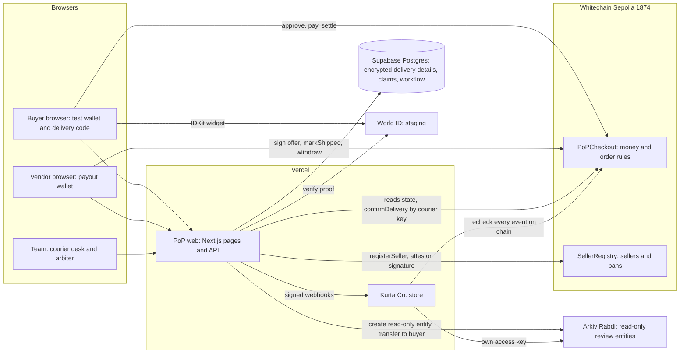
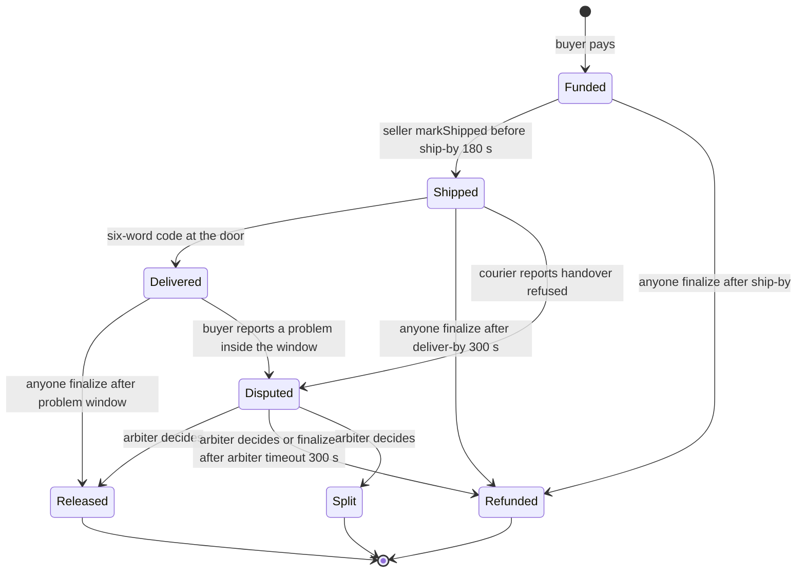
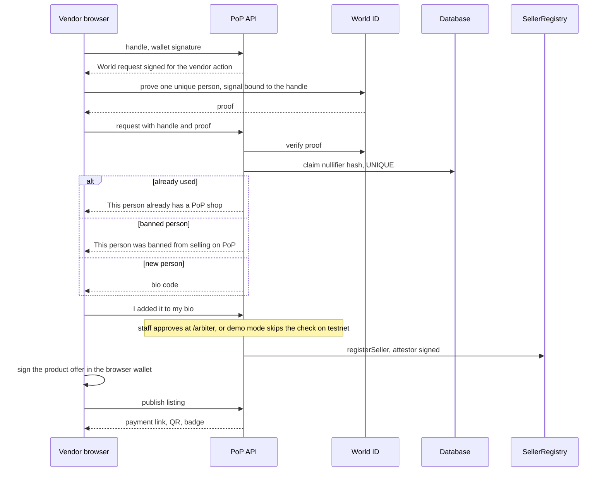
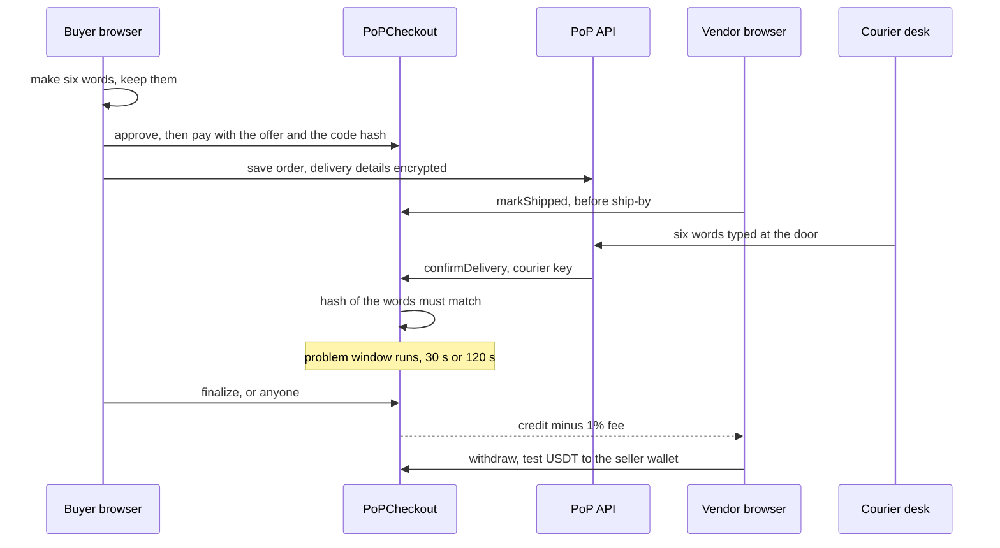
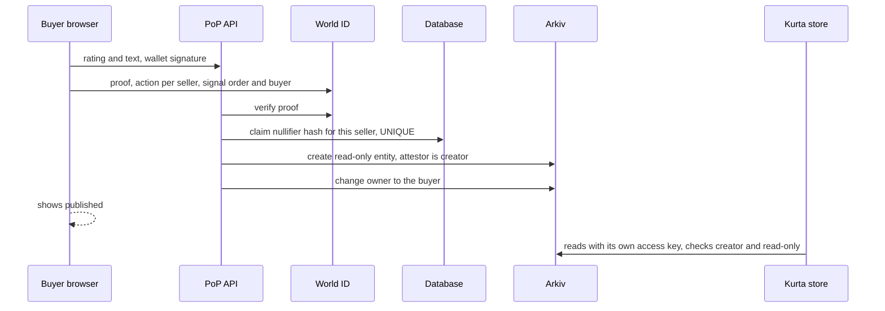

# PoP: Proof of Purchase

**Pay an Instagram seller without trusting them.** The money waits in a contract. It comes back to the buyer automatically if the parcel is late, and it is paid out only when the buyer's own code is entered at the door.

Built from scratch at ETHGlobal Mumbai 2026 (Whitechain, Arkiv and World prize tracks).

1. **"If it doesn't arrive, you get your money back automatically. Nobody can stop that refund, including us."** Anyone can trigger the refund after a missed deadline, and it can only go to the buyer. (One honest exception is listed under [limits](#8-honest-limits).)
2. **"The money is released by the buyer's code at the door; our courier key can't release a single rupee."** The courier can only report a refused handover. Only the contract decides what happens to the money.
3. **"Reputation is earned only from protected deliveries, counts each human once per seller, and lives on Arkiv where any app can read it."** A review needs a paid and delivered order, a World ID proof, and is stored as a read-only Arkiv entity owned by the buyer.

> **Test network only.** Test USDT has no value. The courier is simulated, a team arbiter decides disputes, and World ID runs in its staging environment with the Simulator. Details in [honest limits](#8-honest-limits).

## 2. Live links and how to verify us in 2 minutes

| What | Link |
|---|---|
| PoP (checkout, vendors, tools) | https://pop-web-six.vercel.app |
| Kurta Co., a second shop that sells through PoP | https://kurta-store.vercel.app |
| **Proof page**: contracts, every order with transaction links, Arkiv entities, World log, test counts | https://pop-web-six.vercel.app/proof |
| Seller records | [/verify/meera.jewels](https://pop-web-six.vercel.app/verify/meera.jewels), [/verify/kurta.co](https://pop-web-six.vercel.app/verify/kurta.co) |

**Whitechain Sepolia, chain 1874** (both contracts verified on Blockscout, deployed in block 12330545):

| Contract | Address |
|---|---|
| PoPCheckout | [`0xB6A894bE070951a7331DebFf615e11F7a076794c`](https://explorer.testnet.whitechain.io/address/0xB6A894bE070951a7331DebFf615e11F7a076794c?tab=contract) |
| SellerRegistry | [`0x6D61cD77239dd61e43e943a4Aac006d8A6C285E5`](https://explorer.testnet.whitechain.io/address/0x6D61cD77239dd61e43e943a4Aac006d8A6C285E5?tab=contract) |
| Specified test USDT (6 decimals) | [`0xcedfB56113143d55b2358b8CFbB0dEB5Ad2f55a7`](https://explorer.testnet.whitechain.io/address/0xcedfB56113143d55b2358b8CFbB0dEB5Ad2f55a7) |

> **Verify in 2 minutes**
> 1. Open [/proof](https://pop-web-six.vercel.app/proof). It reads the contract live: the order table has a transaction link for every step of every order. As read on Fri 6 Nov about 22:00 IST: 24 orders (12 released, 9 refunded, 1 split, 2 still open).
> 2. Open any order's `pay` link in Blockscout, then the contract tab: the source is verified.
> 3. In the same table find a **Refunded** order whose settle transaction was sent by a third party (order 2, `finalize`), then the buyer's `withdraw`.
> 4. Open the Arkiv table on `/proof`: two **regular** review entities (orders 1 and 18), creator = our attestor, read-only, owner = the buyer. The other entries are labelled DEV or smoke test.
> 5. Run the read-only query yourself: `npx tsx scripts/arkiv-query.ts` (needs an [Arkiv access key](https://hub.arkiv.network/access-keys)), or use the snippet in [arkiv/how-you-use-arkiv.md](arkiv/how-you-use-arkiv.md).
> 6. Check the refusals: [/verify/bad.bazaar](https://pop-web-six.vercel.app/verify/bad.bazaar) is a banned seller, [/verify/meera.jewels.official](https://pop-web-six.vercel.app/verify/meera.jewels.official) is an unregistered look-alike.

Public pages as they look on Fri 6 Nov evening (screenshots taken with a clean browser; no keys, passcodes or wallets on screen):

| Landing | Checkout | Seller record |
|---|---|---|
|  |  |  |

## 3. The problem and who it is for

A lot of small Indian sellers live on Instagram and WhatsApp. A buyer who has never heard of the shop asks the familiar question: "Do you do cash on delivery?" Cash on delivery lets the buyer wait for the parcel before paying, but the seller carries the cost when parcels are refused. Paying first flips the risk onto the buyer, and a shop's reputation is scattered across posts and comments that anyone can fake or delete.

PoP is a protected prepayment for these sellers. The buyer pays into a contract, not to the seller. If the seller does not ship in time, or the parcel is not delivered in time, the buyer gets the full amount back and nobody has to approve it. The seller is paid when the buyer types a six-word code at the door. Reviews can only come from orders that went through this flow.

Our problem framing comes from the team's own experience, not a market study. What exists today is protected stablecoin prepayment on a test network, not cash handling, rupee settlement or protection across every platform.

## 4. How it works

**For a buyer** (no crypto knowledge needed, the page creates a test wallet in the browser)
1. Open a shop's link or QR (`/p/<name>`). Before paying you see the seller's record, the refund deadlines and the price in rupees and test USDT.
2. Press Pay. In about 15 seconds the page adds test funds, allows the exact amount, pays, and saves your delivery details (stored encrypted).
3. The order page shows the countdown and **your delivery code, six words**. Only a hash of it goes on chain. Screenshot it.
4. The seller ships, the courier asks for the code at the door, the code is entered, and after a short window the seller is paid (1% fee). If anything goes wrong in time, **Settle** refunds you.
5. After the seller is paid you can leave one review, using World ID.

**For a vendor** (`/onboard`; after the World check, demo mode took about 7 seconds to register and publish when rehearsed on Fri 6 Nov)
1. Type the Instagram handle (and the first product's name and price).
2. **World ID check**: a proof that you are one unique person, bound to the handle. One person can open one shop. It does not prove who you are.
3. PoP shows a **bio code** (`POP-` plus six characters). You press "I added it to my bio". With staff approval a team member checks the bio first; in demo mode on testnet that check is skipped and the page says so.
4. The shop is registered on chain, your product offer is signed in your browser wallet, and you get a **payment link, QR and a badge snippet**.
5. At `/dashboard`, in the same browser, you mark orders shipped and withdraw your money. The payout wallet is created in that browser.

**The simulated courier desk** (`/courier`, team passcode): a team member types the buyer's six words for a shipped order. The contract checks the words, not the courier. The courier can also report "handover refused", which only opens a dispute.

**The arbiter** (`/arbiter`): resolves disputes (refund, release or split), bans sellers, and can refund open orders of a banned seller in full.

## 5. Architecture

### a. System

### b. Order state machine

The problem window is **30 s for a seller with at least 3 completed orders and no lost disputes, otherwise 120 s**. An arbiter decision emits `DisputeResolved` and ends in Released, Refunded or Split. Separately, the arbiter can force a full refund of an open order (Funded, Shipped or Disputed) of a banned seller.

### c. Vendor onboarding

### d. Buyer pays, ship, courier code, release

### e. Review with World ID and the Arkiv entity

## 6. Contract design

Solidity 0.8.30 (Prague EVM), OpenZeppelin v5, tested with Foundry. Source: [`contracts/src`](contracts/src).

| Item | Value (read from the deployed contract on Fri 6 Nov) |
|---|---|
| Fee | 100 basis points (1%), taken from the seller's share, paid to the treasury |
| Ship-by / deliver-by | set per offer by the seller; demo offers use 180 s and 300 s |
| Problem window | 30 s (trusted seller) or 120 s |
| Trusted seller | at least 3 completed orders and no lost disputes |
| Arbiter timeout | 300 s, then anyone can finalize into a refund |

| Role | Can |
|---|---|
| Buyer | pay, confirm receipt, report a problem inside the window, withdraw |
| Seller | sign offers (revoke by version), mark shipped, withdraw |
| Anyone | `finalize` an eligible order, `withdrawFor` (money can only go to its owner) |
| Courier | report a refused handover (opens a dispute, moves no money) |
| Arbiter | resolve disputes, ban sellers, force refunds for banned sellers |
| Attestor | sign seller registrations (the registry checks the signature, anyone may send it) |
| Admin (deployer) | grant and revoke roles only. No pause, no function that moves funds |

**Rules that stop abuse:** a buyer cannot be the seller (`SelfPurchase`); offers carry a signature, expiry, version and a unit limit; a banned seller cannot take new orders, and the arbiter can refund its open orders in full (`forceRefundBanned`, never for Delivered or finished orders); a dispute nobody decides within the arbiter timeout refunds the buyer; the delivery code is a hash, entered by anyone who holds it, and the contract pays only the order's own seller or buyer.

**Tests I ran on Fri 6 Nov evening** (commands in [Run it locally](#9-run-it-locally)): Foundry **58 passed, 0 failed** (including an invariant suite with 6 invariants); vendor check unit test **11 checks**; fork end-to-end **66 checks**; merchant end-to-end **48 checks** on the fork. An earlier run of the merchant end-to-end on Whitechain Sepolia in real time passed 47 checks ([docs/evidence.md](docs/evidence.md); not re-run tonight).

## 7. Sponsors

### Whitechain (Operate: Stablecoin Payments for Business)
**What the prize asks for:** a drop-in merchant checkout or payment link that a demo app adds in about 20 lines, with merchant and customer views, and extra credit for refunds and accountant exports.
**What we use:** Whitechain Sepolia (an OP Stack chain, chain 1874, gas token WBT, 1 s blocks per Whitechain's docs) and the specified Whitechain test USDT. We deployed and verified both contracts and ran real orders: release, deadline refund, dispute split, and one order paid from a real phone over mobile data.
**Why:** the refund after a missed deadline is a public contract call, so it does not depend on PoP.
**Merchant integration:** `@pop/checkout-sdk` (a private workspace package, not on npm). Kurta Co.'s whole checkout route is [18 lines](apps/demo-store/src/app/api/checkout/route.ts), its signed-webhook receiver [31 lines](apps/demo-store/src/app/api/pop/webhook/route.ts), and the SDK's browser call is 2 lines. **Customer view:** checkout and order pages. **Merchant view:** the Kurta orders page and the PoP `/dashboard` with an order CSV that includes transaction hashes (states, amounts and hashes, not a full fee reconciliation).
**Evidence:** [docs/evidence.md](docs/evidence.md) (every transaction), [/proof](https://pop-web-six.vercel.app/proof), [WHITECHAIN_FEEDBACK.md](WHITECHAIN_FEEDBACK.md) (what we hit: the 10,000 block log limit, a 403 when one IP polled hard, faucet amounts, the DEX approval).

### Arkiv (Build on Arkiv, from scratch)
**What the prize asks for:** a new app whose data lives on Arkiv, judged on four equal criteria, each answered in a file in [`arkiv/`](arkiv).
**What we use:** the Rabdi testnet (chain 7794095). A review is an Arkiv **entity** of schema `pop_review_v1` with indexed **attributes** (seller, order, rating and more) and an **expiry** (about 180 days). Our attestor is the entity's **creator**; it is created **read-only** and its **owner** is then changed to the buyer.
**Why:** Arkiv's docs note that anyone can write an entity with your schema's tag, so readers must not trust the tag alone. Our readers accept an entity only if its creator is our attestor, it is read-only, and its payment transaction is a real order on our contract. Kurta Co. does exactly that with **its own access key**, without calling PoP's API.
**State now:** 12 entities seen by both keys: 2 real World-verified reviews, 9 labelled DEV (from fork tests) and 1 smoke test. **Evidence:** [arkiv/schema.md](arkiv/schema.md), [how-you-use-arkiv.md](arkiv/how-you-use-arkiv.md), [why-arkiv.md](arkiv/why-arkiv.md), [reach.md](arkiv/reach.md), [friction.md](arkiv/friction.md), and the entity table on `/proof`.

### World (Best Use of IDKit)
**What the prize asks for:** IDKit solving a real trust moment, a minimum sufficient credential and why, server-side verification, one success and one meaningful alternative path, and a short debrief.
**Two trust moments:** (1) **reviews**: one review per human per seller, so reputation cannot be farmed (action per seller, signal = order and buyer); (2) **vendor onboarding**: one human, one shop (one action, signal = the handle).
**Credential:** the `proofOfHuman` preset. We need uniqueness, not identity, so it is the least that works. A person is a **nullifier** per action; we store only its sha256 and refuse repeats. Verification happens on our server through World's verify endpoint, in the staging environment.
**Evidence:** two reviews verified with the Simulator (order 1 at 16:43 IST, order 18 at 19:12 IST) and a **same-person replay refused** twice on order 17, all in the World log on `/proof`. A cancelled request is still to be recorded. The vendor check is unit tested (11 checks) but a real vendor proof has not been run yet. **Debrief:** [docs/WORLD_DEBRIEF.md](docs/WORLD_DEBRIEF.md) (times, friction, the one change we would ask for).

## 8. Honest limits

- **Test USDT only**, on a test network. Nothing here moves real money.
- **World ID is staging with the Simulator.** A phone cannot complete a staging review (the widget asks for the real World App). We have not checked which World credentials a buyer in India can get today.
- **The ban block is a PoP database rule**, mirrored from the on-chain ban. The contracts ban wallets and handles and know nothing about World identities. Someone with another World identity is not stopped.
- **The courier is simulated** (a team member with a passcode and a server key). **One arbiter key decides disputes.**
- **Demo timings are minutes and seconds**; real orders would use days.
- **Demo mode skips the bio check on testnet.** Shops registered that way are recorded as "handle not checked" (tier 0), and the server's faucet wallet pays their registration fee.
- **A valid code entered before anyone calls `finalize` still wins.** After a missed delivery deadline the contract does not reject a correct code, so the refund is not irrevocable until someone settles it.
- **Nobody settles for you.** A refund or release needs one transaction from anyone; the order page offers it, with an opt-in auto-settle that needs the page open.
- **Delivery details** are encrypted in our database with a key we hold. Payments, wallets, timings and review entities are public.
- **Only tested by script, not clicked in a browser by a person:** `/onboard`, the `/arbiter` buttons, `/dashboard` shipping, the `/courier` page, dispute and banned-seller refunds on the live testnet, and the newest refusal messages. A real vendor World proof, the Vercel cron firing in Vercel's own log, and Safari are unchecked. See [docs/repo-map.md](docs/repo-map.md).
- **Not built:** outcome entities on Arkiv, Chrome extension, Agent Pass, Swarm, gasless checkout. No prize result is guaranteed.

## 9. Run it locally

1. Node 22 or newer, Git (with Git Bash on Windows), [Foundry](https://book.getfoundry.sh), and a Supabase Postgres project.
2. `git clone --recurse-submodules https://github.com/Dhruva-0206/pop.git && cd pop && npm ci`
3. `cp .env.example .env` and fill it (names and meaning in [docs/deployment.md](docs/deployment.md)). Never commit `.env`. Do **not** run `npm run wallets` on the team's existing setup.
4. Set `NETWORK_MODE=fork`, then in three terminals from the repo root:
   `npm run fork`, then `npm run db:reset-fork && npm run fork:up && npm run seed:merchant && POP_DEV_SKIP_WORLD=1 npm run dev:web`, then `npm run dev -w @pop/demo-store`.
5. PoP is at http://localhost:3000, Kurta at http://localhost:3001. The fork uses chain 31337, so nothing signed there can replay on Whitechain.
6. Tests: `cd contracts && forge test` (Git Bash), `npx tsx scripts/test-vendor-verification.ts`, `npx tsx scripts/e2e-fork.ts`, `npx tsx scripts/e2e-merchant.ts`; live check: `npx tsx scripts/vercel-smoke.ts <PoP URL> <store URL>`.
7. `POP_DEV_SKIP_WORLD=1` is for a local dev server only. It is refused on deployed builds.

| Folder | What is in it |
|---|---|
| `contracts/` | `PoPCheckout`, `SellerRegistry`, tests, deploy script |
| `apps/web/` | PoP pages and API (Next.js 16, React 19, Tailwind) |
| `apps/demo-store/` | Kurta Co., a separate shop and database schema |
| `packages/shared/`, `packages/checkout-sdk/` | shared chain, database and Arkiv code; the merchant SDK |
| `scripts/` | deploy, fork, seed, end-to-end tests, smoke and demo tools |
| `supabase/migrations/` | the database schema |
| `arkiv/`, `docs/` | Arkiv judging files, evidence, deployment, demo script, repo map |

**AI use:** AI tools helped with planning, code and docs. [AI_USAGE.md](AI_USAGE.md) lists where. The planning documents are in [`specs/`](specs). **Dependencies and licence:** public libraries (Next.js, viem, OpenZeppelin, the Arkiv SDK, World IDKit and others) are listed in the manifests; MIT licence, see [LICENSE](LICENSE).

**Team** (from the git history): Dhruva Somen Chakrabarty, Shantanu Somwanshi, Tanishqa Chopade.
