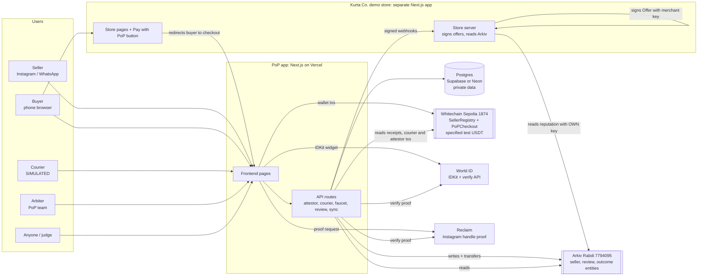
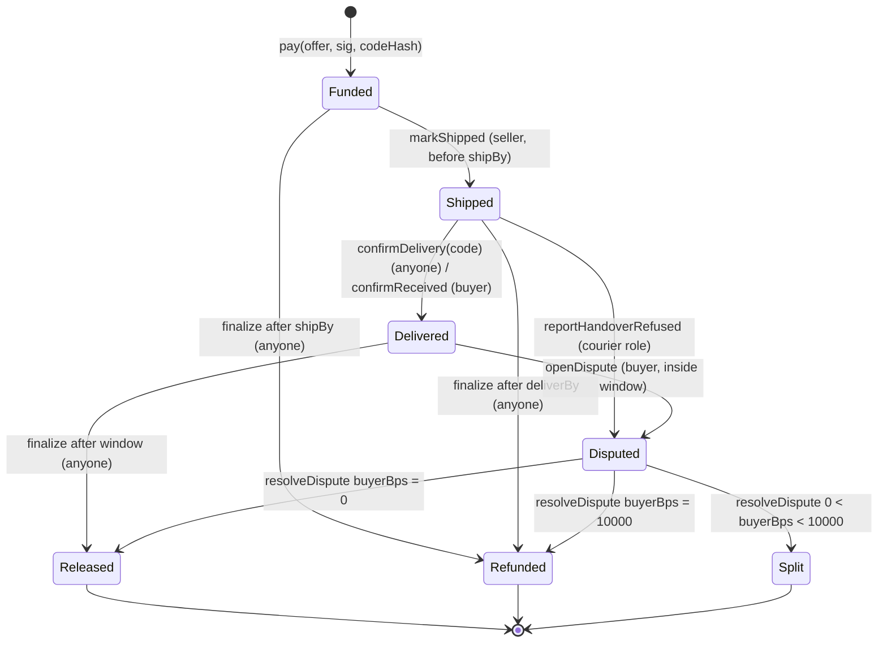
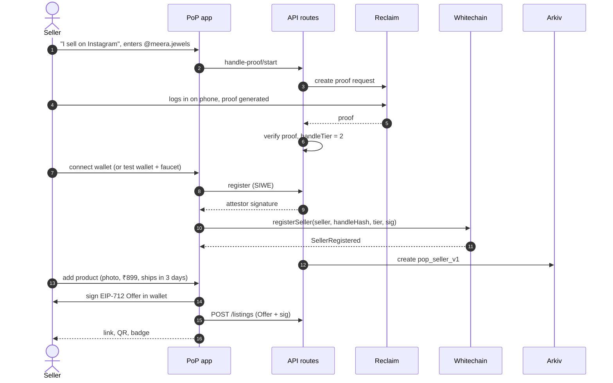
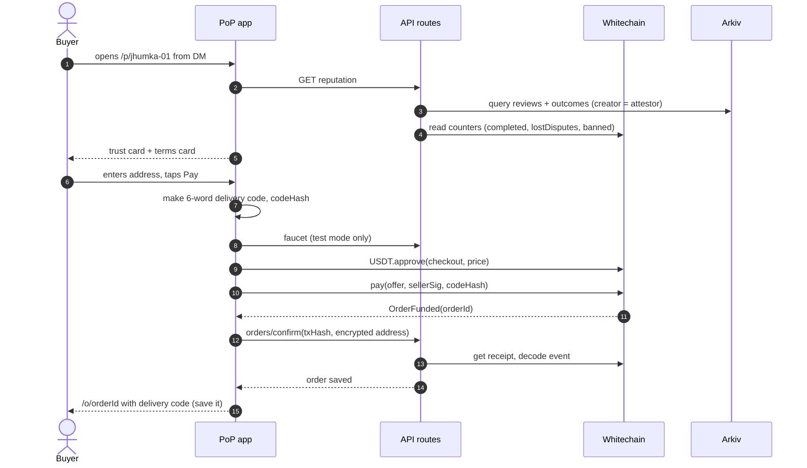
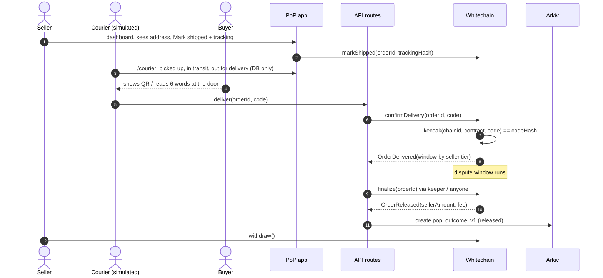
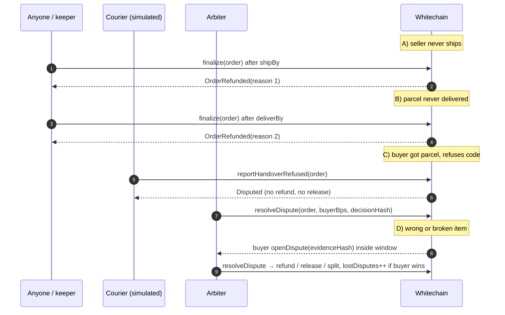
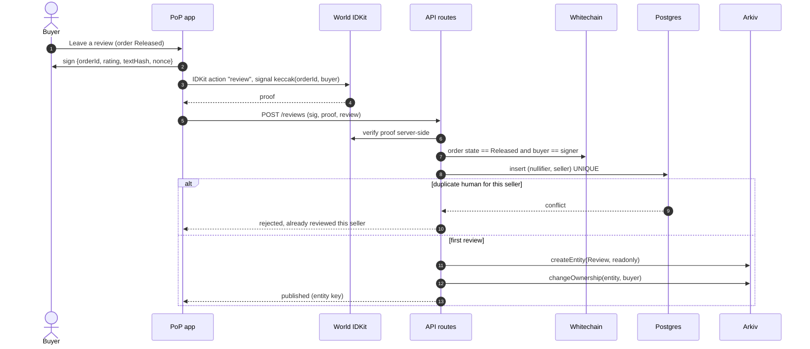
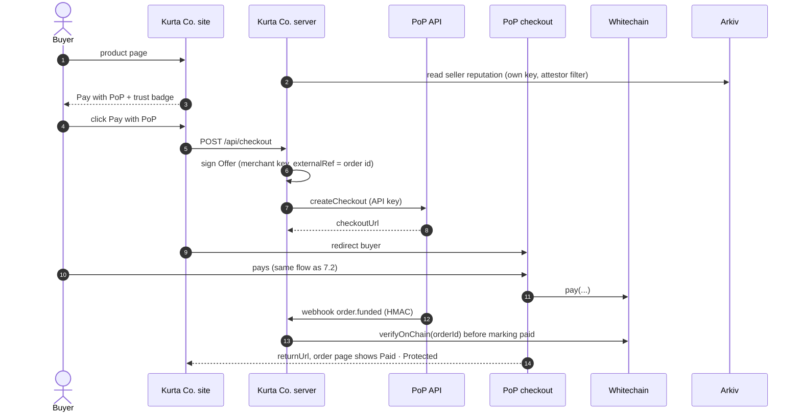

# PoP (Proof of Purchase): Technical Architecture

**Frontend, backend, contracts, sponsor integrations, data flows and the full end-to-end process.**

ETHGlobal Mumbai 2026 · From Scratch track · Written Thu 5 Nov 2026, ~10:30 PM IST · Deadline **Sat 7 Nov, 9:00 AM IST** (aim 7:00 AM).

This is the engineering companion to `Bharosa_Build_Spec_v3.md` (the product decisions, written before the rename; read "PoP" there as PoP). It was checked against the official rules and sponsor-requirement files the team supplied on 5 Nov. Anything marked **UNVERIFIED** must be confirmed from live docs or a mentor before relying on it. Section 15 lists them.

> **Name:** the product is **PoP: Proof of Purchase** (renamed from PoP on 5 Nov). Write "PoP" the same way everywhere: repo, UI, README, submission form.

---

## 0. The architecture in one paragraph

One **Next.js app** (frontend + API routes) on Vercel serves the seller, buyer, courier, arbiter and proof screens. Money and order rules live in two Solidity contracts on **Whitechain Sepolia** (chain 1874), paid in Whitechain's specified test USDT. Public reputation (seller profiles, verified reviews, order outcomes) is written to **Arkiv** (Rabdi, chain 7794095) by our attestor wallet, after the matching Whitechain event has been checked. Reviews are locked (`readonly`) and handed to the buyer's wallet. **World IDKit** gates only one action, publishing a review, and is verified on our server. Private data (buyer address, World nullifiers) sits in **Postgres**, never on a public chain. A **second app**, an independent demo store, integrates "Pay with PoP" in about 20 lines and reads the seller's reputation from Arkiv with its own key. That proves the record is portable.

**The one thing to remember:** Whitechain decides who gets the money, Arkiv shows the reputation, World decides who may review, and our server only checks and relays. It can never move money by itself.

---

## 1. Requirements this architecture must satisfy

Official items come from the team-supplied ETHGlobal FAQ and prize-page text (5 Nov). "Where satisfied" points to sections of this document.

| Source | Requirement (official) | Where satisfied |
|---|---|---|
| ETHGlobal | Fresh work after 9 PM Thu; steady commits; no single big upload | §13 repo + commit plan |
| ETHGlobal | AI use disclosed; if spec-driven, include specs and prompts | `AI_USAGE.md`, `specs/` folder (§13) |
| ETHGlobal | Video 2–4 min, ≥720p, human voice, **not recorded on a phone**, not sped up, no AI voiceover | §14 |
| ETHGlobal | Finalist: 4-min demo + 3-min Q&A | §10 use case is the demo order |
| Whitechain Operate | **Reusable drop-in integration** (widget/SDK/payment link) that a **separate demo app adds in ~20 lines** | §5.5 checkout SDK, §5.6 demo store |
| Whitechain Operate | **Merchant and customer views**; extra credit for refunds or accounting export | §5.1 screens, CSV export |
| Whitechain Operate | Contracts on Whitechain Sepolia **1874**, **verified** on explorer | §5.3, §12 |
| Whitechain Operate | ≥1 real payment in the **specified USDT** `0xcedfB56113143d55b2358b8CFbB0dEB5Ad2f55a7`; self-minted doesn't count; explorer link in README | §5.3, §12 |
| Whitechain Operate | README line on why on-chain stablecoin settlement adds value; video shows all parties; `WHITECHAIN_FEEDBACK.md` | §13 |
| Arkiv Build (scratch) | Write via `@arkiv-network/sdk` or JSON-RPC to current testnet; **≥1 user-visible feature reads from Arkiv**; not a write-only log | §6.2 |
| Arkiv Build (scratch) | README: writer wallet(s) + one executable query; `/arkiv/schema.md`, `friction.md`, `reach.md`, `why-arkiv.md`, `how-you-use-arkiv.md`; open-source license | §6.2, §13 |
| World IDKit | Real trust moment; minimum sufficient credential; verification on server or on-chain | §6.3 |
| World IDKit | Success path + denied/cancelled/ineligible path; integration debrief | §6.3, §9.6 |
| Rules doc | No buyer PII or plaintext order details on a public chain | §8 data placement |

---

## 2. System diagram

### 2.1 Context (who talks to what)



### 2.2 Layer view (ASCII, for slides)

```
 ┌──────────────────────────── ENTRY POINTS ─────────────────────────────┐
 │  Instagram/WhatsApp: link + QR            Small website: Pay with PoP│
 └───────────────┬───────────────────────────────────────┬────────────────┘
                 v                                       v
 ┌────────────── BHAROSA APP (Next.js on Vercel) ────────────────────────┐
 │ Pages: /onboard /s/[handle] /p/[listing] /o/[order] /verify/[handle]  │
 │        /dashboard /courier /arbiter /proof /checkout/[session]        │
 │ API:   handle-proof · register · listings · checkout-sessions ·      │
 │        orders/confirm · courier · faucet · review · sync · webhooks  │
 └──────┬──────────────────┬──────────────────┬──────────────┬──────────┘
        │ private          │ money + rules    │ public       │ identity
        v                  v                  v reputation   v
   ┌─────────┐   ┌───────────────────┐   ┌──────────┐   ┌──────────────┐
   │Postgres │   │Whitechain Sepolia │   │  Arkiv   │   │World IDKit   │
   │address, │   │PoPCheckout    │   │ Rabdi    │   │(reviews only)│
   │nullifier│   │SellerRegistry     │   │ readonly │   │Reclaim       │
   │sessions │   │test USDT          │   │ reviews  │   │(seller handle)│
   └─────────┘   └───────────────────┘   └────┬─────┘   └──────────────┘
                                              │ read with its own key
                                   ┌──────────v──────────┐
                                   │ Kurta Co. demo store│
                                   └─────────────────────┘
```

---

## 3. Tech stack

Versions: use the latest stable release at install time unless noted. Pin exact versions in `package.json` once it works, and record them in the README.

| Layer | Choice | Why / notes |
|---|---|---|
| Language | TypeScript everywhere off-chain; Solidity ^0.8.24 on-chain | One language for frontend and backend |
| Web framework | **Next.js (App Router)** + React | Frontend and API routes in one deploy |
| Styling | Tailwind CSS (+ shadcn/ui optional) | Fast, mobile-first |
| Wallet / chain client | **viem** + **wagmi** (injected MetaMask) + **test-mode burner wallet** (viem `generatePrivateKey`) | Judges can pay without installing a wallet |
| Contracts | **Foundry** (forge, cast) + OpenZeppelin Contracts (`SafeERC20`, `EIP712`, `ECDSA`, `ReentrancyGuard`, `AccessControl`) | Invariant and fuzz tests. On Windows, use WSL2 or Git Bash. Fallback: Hardhat 3 |
| Database | **Postgres** (Supabase or Neon free tier) + Drizzle ORM (or plain `pg`) | Private state only |
| Encryption | Node `crypto` AES-256-GCM, key in env | Buyer address at rest |
| Auth | **SIWE** (Sign-In With Ethereum, viem's `siwe` utils) + httpOnly session cookie | Seller dashboard, arbiter, courier role pages |
| Arkiv | **`@arkiv-network/sdk` 1.0.x** (viem peer), server-side only | Typed schemas, `createEntity`, `changeOwnership`, `select…fetch()` |
| World | **IDKit** (React widget) + backend verification against World's verify API | Follow current docs (`docs.world.org/world-id/idkit/integrate`); names may differ from older examples |
| Handle proof | **Reclaim Protocol** JS SDK (Instagram provider) | Time-boxed 90 min; fallback = staff-verified bio code |
| QR | `qrcode` (generate) + `@zxing/browser` or `html5-qrcode` (scan in the courier page) | Delivery code and payment-link QR |
| Wordlist | BIP-39 English list (`@scure/bip39`) | 6-word delivery code |
| Hosting | **Vercel** (two projects: `pop-web`, `kurta-demo-store`) | Free, fast deploys |
| Keeper | `scripts/keeper.ts` (Node, run on a laptop during the demo) + a public "Finalize" button | Calls `finalize` on expired orders. No cron dependency |
| Testing | Foundry (unit, fuzz, invariant) · Vitest (API logic) · Playwright (1 happy-path smoke) | Test count goes in the pitch |
| Coding agents | Install Arkiv's official skills repo (`github.com/Arkiv-Network/skills`) into the team's AI coding tool | Verified SDK 1.0.1 recipes. Disclose in `AI_USAGE.md` |

**Windows setup notes:** Node 26 is very new; if a tool breaks, install Node 22 LTS via nvm-windows. Foundry runs best in WSL2. Set `git config --global user.name/user.email` before the first commit. `.env` goes in `.gitignore` before the first commit.

---

## 4. Keys, roles and trust boundaries

Every key is a throwaway testnet wallet. **Never real funds; never paste a private key into chat.** Keys live in Vercel env vars and local `.env` only.

| Key / role | Held by | Can do | Can NOT do | Env var |
|---|---|---|---|---|
| Deployer / admin | Contracts lead's laptop | Deploy, set role addresses once | Move order funds | `DEPLOYER_PK` (local only) |
| **Attestor** | PoP API (Vercel env) | Sign seller registrations; write Arkiv entities; transfer reviews to buyers | Move money; edit a review after creation (readonly) | `ATTESTOR_PK` |
| **Courier** | PoP API (courier simulator) | Submit a buyer's delivery code (anyone can); call `reportHandoverRefused` (Shipped → Disputed) | **Release or refund money** | `COURIER_PK` |
| **Arbiter** | Team member via `/arbiter` (MetaMask) | `resolveDispute`, `ban` | Touch non-disputed orders | wallet in browser |
| **Faucet** | PoP API | Send capped WBT + test USDT to new burner wallets | Anything in the contract | `FAUCET_PK` |
| Treasury | Contract config | Receive `feeBps` | — | address only |
| Merchant key (demo store) | Kurta Co. server | Sign EIP-712 Offers for its own orders | Anything for other sellers | `MERCHANT_PK` (demo-store env) |
| Buyer burner | Buyer's browser `localStorage` | Pay, confirm received, open dispute, sign review request | — | never leaves browser |

**Trust boundary rule:** the API never decides money movement. It only (a) relays what the contract already enforces and (b) writes public records after checking the chain.

---

## 5. Components

### 5.1 Frontend (PoP app)

| Route | User | Main components | Reads | Writes |
|---|---|---|---|---|
| `/` | everyone | Hero ("If it doesn't arrive, you get your money back"), two CTAs | — | — |
| `/onboard` | seller | `HandleProofStep` (Reclaim/fallback), `WalletStep` (MetaMask or burner), `ProductStep` (photo, price, ship days → **signs EIP-712 Offer**), `ShareStep` (link, QR, badge PNG), visible timer | — | API `/seller/*`, `/listings`; contract `registerSeller` |
| `/s/[handle]` | buyer | Seller mini-page: trust card + product grid | Arkiv, contract counters, DB listings | — |
| `/p/[listingId]` | buyer | `TrustCard`, `TermsCard` (renders Offer fields; "verify on-chain" link), `AddressForm`, `PayButton` (approve → pay), `TestModeBanner` | DB listing + Offer; Arkiv reputation | DB checkout session; contract `approve`, `pay` |
| `/checkout/[sessionId]` | buyer (from demo store) | Same as `/p` but for an external cart Offer; returns to the merchant's `returnUrl` | DB session | same |
| `/o/[orderId]` | buyer | `OrderTimeline`, `DeliveryCode` (QR + 6 words), `ConfirmReceivedButton`, `DisputeButton` (inside window), `ReviewFlow` (after Released) | contract order state | contract `confirmReceived`, `openDispute`; API `/reviews` |
| `/verify/[handle]` | anyone | Big green/amber/red status, counts with denominators, recent verified reviews, "how to check this yourself" (raw query) | Arkiv + contract | — |
| `/dashboard` | seller (SIWE) | Orders by state, decrypted ship-to address, `MarkShipped` (tracking no.), `Withdraw`, CSV export, API key + webhook URL for websites | DB + contract | contract `markShipped`, `withdraw` |
| `/courier` | team (SIWE, courier role) | Labelled **SIMULATED COURIER**. Order list → Picked up → In transit → Out for delivery → **Scan code** / **Handover refused** | DB + contract | API `/courier/*` (server submits tx) |
| `/arbiter` | team (SIWE, arbiter) | Dispute list, evidence, **agreed terms vs current listing**, Refund / Release / Split, Ban seller | DB + contract | contract `resolveDispute`, `ban` |
| `/proof` | judges | All contract addresses, tx hashes per order, Arkiv entity keys + creator/owner, runnable query, World verification log (no secrets), test count, "Re-sync" and "Finalize expired" buttons | everything | API `/sync`, contract `finalize` |

**UX rules:** rupees next to USDT ("₹899 · 1.00 test USDT"); no words like escrow, nullifier or chain ID on buyer screens; every state change shows a short explorer link.

### 5.2 Backend (Next.js API routes)

All routes validate input with **zod**, rate-limit by IP (a simple Postgres counter is fine), and return errors without secrets.

| Method + path | Auth | Does | Touches |
|---|---|---|---|
| `POST /api/seller/handle-proof/start` | none | Create a Reclaim request (or issue a bio code) | Reclaim, DB |
| `POST /api/seller/handle-proof/verify` | none | Verify the Reclaim proof (nonce, timestamp, audience), or mark the bio code pending staff check; returns `handleTier` | Reclaim, DB |
| `POST /api/seller/register` | SIWE (seller wallet) | Attestor signs `(seller, handleHash, handleTier, chainId, nonce)`; client submits `registerSeller`; then API writes `pop_seller_v1` to Arkiv | DB, Arkiv |
| `POST /api/listings` | SIWE seller | Store listing + seller-signed Offer; compute `termsHash` from canonical JSON | DB |
| `POST /api/checkout-sessions` | **merchant API key** (website) | Store an external cart Offer (signed by the merchant server), `returnUrl`, `webhookUrl`; return `checkoutUrl` | DB |
| `POST /api/orders/confirm` | none (tx is the proof) | Read receipt by `txHash`, decode `OrderFunded`, check contract address + chain, store order, attach encrypted address, fire `order.funded` webhook | Whitechain, DB |
| `POST /api/courier/:orderId/status` | SIWE courier | Advance the simulated status (DB only, labelled) | DB |
| `POST /api/courier/:orderId/deliver` | SIWE courier | Submit `confirmDelivery(orderId, code)` with the courier key (any wallet could) | Whitechain |
| `POST /api/courier/:orderId/refused` | SIWE courier | `reportHandoverRefused(orderId)` → Disputed | Whitechain |
| `POST /api/faucet` | none, per-device + per-IP cap | Send capped WBT + test USDT to a new burner once | Whitechain |
| `POST /api/reviews` | buyer wallet signature + World proof | §6.3 pipeline: verify proof → check order `Released` + buyer → unique `(nullifier, seller)` → Arkiv create (readonly) → `changeOwnership` to buyer | World, Whitechain, DB, Arkiv |
| `POST /api/sync/:orderId` | none (idempotent) | Read on-chain state; if terminal and not yet published, write `pop_outcome_v1`; fire webhook | Whitechain, Arkiv, DB |
| `GET /api/reputation/:handle` | none | Bounded read proxy for our own UI: Arkiv rows from the trusted creator + contract counters | Arkiv, Whitechain |
| `GET /api/export.csv` | SIWE seller | Orders with tx hashes, amounts, fees, states | DB, Whitechain |

**Idempotency:** every chain-derived write is keyed by `(chainId, txHash, logIndex)` in a `processed_events` table. Arkiv writes record `entityKey` and a status (`pending | synced | failed`). The proof page shows failures with a Re-sync button.

### 5.3 Smart contracts (Whitechain Sepolia, chain 1874)

Full function list and rationale: `Bharosa_Build_Spec_v3.md` §6. This is the integration view.

**Offer (EIP-712).** One struct serves both entry points:

```solidity
struct Offer {
  address seller;      // registered seller wallet
  bytes32 listingId;   // social listing id, or keccak(merchant order id) for websites
  bytes32 termsHash;   // keccak of canonical terms JSON (title, variant, images, policy)
  bytes32 externalRef; // website order id hash; 0 for social listings
  uint256 price;       // test-USDT base units (read decimals() at runtime; don't assume 6)
  uint32  shipWithin;  // seconds after funding
  uint32  deliverWithin;
  uint32  maxUnits;    // stock (1 for website carts)
  uint64  validUntil;
  uint256 version;     // seller can revoke all lower versions
}
// EIP-712 domain: { name: "PoP", version: "1", chainId: 1874, verifyingContract: PoPCheckout }
```

**Events the off-chain side depends on:**

```solidity
event SellerRegistered(address indexed seller, bytes32 indexed handleHash, uint8 handleTier);
event SellerBanned(address indexed seller, bytes32 indexed handleHash);
event OrderFunded(uint256 indexed orderId, address indexed buyer, address indexed seller,
                  bytes32 listingId, bytes32 externalRef, bytes32 termsHash, uint256 amount,
                  uint64 shipBy);
event OrderShipped(uint256 indexed orderId, bytes32 trackingHash, uint64 deliverBy);
event OrderDelivered(uint256 indexed orderId, bool viaCode, uint32 disputeWindow);
event HandoverRefused(uint256 indexed orderId);
event DisputeOpened(uint256 indexed orderId, bytes32 evidenceHash);
event DisputeResolved(uint256 indexed orderId, uint16 buyerBps, bytes32 decisionHash);
event OrderReleased(uint256 indexed orderId, uint256 sellerAmount, uint256 fee);
event OrderRefunded(uint256 indexed orderId, uint256 amount, uint8 reason); // 1 no-ship, 2 no-delivery, 3 dispute
event Withdrawn(address indexed account, uint256 amount);
```

**Delivery code check:**

```solidity
require(keccak256(abi.encodePacked(block.chainid, address(this), code)) == o.codeHash, "bad code");
```

**State machine:**



**Deploy and verify:** `forge script script/Deploy.s.sol --rpc-url $WHITECHAIN_RPC --broadcast`, then verify on `explorer.testnet.whitechain.io` (**UNVERIFIED**: which verifier, Blockscout or Etherscan-style; ask the mentor). Record addresses in `docs/evidence.md` and README.

### 5.4 Delivery code (buyer side)

1. On the checkout page, before `pay`: `secret = randomBytes(16)` → shown as **6 BIP-39 words** (66 bits; the words are the canonical secret) and a QR of the words.
2. `codeHash = keccak256(encodePacked(1874, checkoutAddress, utf8(words)))` → passed to `pay`.
3. Words stored only in the buyer's `localStorage` (`pop:order:<id>:code`) plus a "Save your delivery code" prompt (copy / screenshot).
4. Courier page scans the QR (or types the words) → API calls `confirmDelivery(orderId, utf8(words))`.

The server never sees the code until the courier submits it at the door, and by then it's public anyway, because it can only release to the seller.

### 5.5 "Pay with PoP" SDK (Whitechain's ~20-line drop-in)

Package folder: `packages/checkout-sdk` (published to the repo; npm publish is optional). Two halves:

**Merchant server (Node), about 12 lines:**

```ts
import { PoPMerchant } from "@pop/checkout-sdk/server";

const pop = new PoPMerchant({
  apiKey: process.env.POP_API_KEY!,          // from the PoP seller dashboard
  merchantPrivateKey: process.env.MERCHANT_PK!,  // signs the EIP-712 Offer
  baseUrl: "https://pop-web.vercel.app",
});

export async function POST(req: Request) {
  const { orderId, items, total } = await req.json();
  const { checkoutUrl } = await pop.createCheckout({
    externalOrderId: orderId, priceUsdt: total, title: items[0].name,
    shipWithinDays: 3, deliverWithinDays: 7,
    returnUrl: `https://kurta-demo.vercel.app/orders/${orderId}`,
    webhookUrl: "https://kurta-demo.vercel.app/api/pop-webhook",
  });
  return Response.json({ checkoutUrl });
}
```

**Merchant frontend, about 6 lines:**

```html
<script src="https://pop-web.vercel.app/widget.js" defer></script>
<div data-pop-button data-seller="0xKurtaCoSeller" data-session-endpoint="/api/checkout"></div>
<!-- widget.js renders the button + a live trust badge, calls the endpoint, then redirects to checkoutUrl -->
```

**Webhook handler (merchant), about 6 lines:** verify the `X-PoP-Signature` HMAC, then **independently** confirm the order on-chain with `pop.verifyOnChain(orderId)` before marking it paid. The SDK warns that a frontend callback is never proof of payment.

Webhook events: `order.funded`, `order.shipped`, `order.delivered`, `order.released`, `order.refunded`, `order.disputed`. Payload: `{ event, orderId, externalOrderId, txHash, state, timestamp }`. HMAC-SHA256 over the raw body with a per-merchant secret; reject if older than 5 min.

### 5.6 Kurta Co. demo store (separate app)

- Separate Vercel project, separate env: its own `MERCHANT_PK`, `POP_API_KEY`, and **its own `ARKIV_ACCESS_KEY`**.
- Product page "Hand-block cotton kurta – ₹1,299" with the Pay with PoP button (§5.5).
- **Trust badge reads Arkiv directly** from the store's own server with the SDK, filtered to PoP's published attestor address. It does **not** call the PoP API. This is the Arkiv "reach" proof and the Whitechain "separate demo app" proof in one.
- Order page updates from webhooks, each one re-checked on-chain.

### 5.7 Courier simulator

- Page `/courier`, visibly labelled **SIMULATED COURIER**. A team member operates it on a laptop.
- Statuses before delivery are DB-only (no chain truth claimed).
- Only two on-chain actions: **deliver with code** (anyone could do it; we use the courier wallet for gas) and **handover refused** (courier role → Disputed).
- Shows the camera QR scanner for the buyer's code. A typed 6-word fallback is required (laptop cameras fail in hall lighting).

### 5.8 Test-mode wallet and faucet

- On the first visit to a checkout, if no injected wallet is present, the app offers "Use a test wallet". A burner key is created in `localStorage` with a **TEST MODE** banner.
- `POST /api/faucet` sends e.g. 0.05 WBT (gas) + 2 test USDT once per burner, capped per IP and per day, with a global daily cap.
- **UNVERIFIED:** how much test USDT the Whitechain faucet gives us (gate). If it's scarce, price products at 1 test USDT ≈ ₹899 and say so on screen.
- Not claimed as gasless; we are not entering Whitechain Scale.

---

## 6. Sponsor integrations in depth

### 6.1 Whitechain: Operate (stablecoin payments for business)

| Aspect | Implementation |
|---|---|
| What runs there | `SellerRegistry` + `PoPCheckout`; all buyer funds held in the specified test USDT |
| Drop-in integration | `@pop/checkout-sdk` (§5.5) used by the Kurta Co. app in ~20 lines |
| Merchant view | `/dashboard` (orders, ship, withdraw, CSV export, API key, webhook URL) + Kurta Co. admin order page |
| Customer view | `/p`, `/checkout`, `/o` (terms card, timeline, delivery code, dispute) |
| Beyond the first payment | Deadline refunds, dispute refund/split, seller payouts, platform fee, **accounting CSV with tx hashes**, webhooks |
| Why on-chain stablecoin settlement (README line) | "The refund deadline is enforced by code that neither the seller nor PoP can override, and settlement works the same for a buyer in Dubai as in Pune. Cross-border buyers have no COD at all." |
| Evidence | Verified contract links; pay, release and refund tx links; video showing buyer, seller, courier, arbiter; `WHITECHAIN_FEEDBACK.md` |
| Remove it, what breaks? | The refund becomes our promise instead of code, and the merchant has nothing independent to verify payment against |

### 6.2 Arkiv: Build on Arkiv (from scratch)

**SDK facts used** (from Arkiv's official skills repo, SDK 1.0.1, verified by Arkiv 30 Oct to 3 Nov 2026; check the installed package): typed schemas with `defineSchema`; only `.indexed()` columns are filterable; strings ≤128 bytes; ≤31 named columns; expiry in blocks (~2 s), max 7,884,000 blocks (~182 days); flags `readonly` / `permissionlessExtension` fixed at creation; `$creator` never changes, `$owner` changes on transfer; queries read current state only; each query costs 10 of 100M quota units per key; **keep access keys server-side**.

**Schemas (`packages/arkiv/schemas.ts`):**

```ts
import { defineSchema, str, u64, u256, addr, bytes } from "@arkiv-network/sdk/schema";

export const Seller = defineSchema("pop_seller_v1", {
  seller: addr().indexed(), handle: str().indexed(), handle_tier: u64().indexed(),
  status: str().indexed(),             // active | banned
  display: bytes(),                    // JSON: name, city, categories (no PII)
});

export const Review = defineSchema("pop_review_v1", {
  seller: addr().indexed(), order_id: u256().indexed(), rating: u64().indexed(),
  created_at: u64().indexed(),
  reviewer_key: str().indexed(),       // hex keccak(nullifier, seller), never the raw nullifier
  buyer_history: u64().indexed(),      // 1 = first protected purchase, 2 = 2–5, 3 = 6+
  pay_tx: str(), text: bytes(), buyer_sig: bytes(),
});

export const Outcome = defineSchema("pop_outcome_v1", {
  seller: addr().indexed(), order_id: u256().indexed(),
  outcome: str().indexed(),            // released | refunded_noship | refunded_nodelivery | dispute_buyer | dispute_seller | split
  settled_at: u64().indexed(), tx: str(),
});
```

**Writer (`packages/arkiv/writer.ts`, server only):**

```ts
// createEntity(schema, values, { expiration, flags }), then hand the review to the buyer
const res = await wallet.createEntity(Review, values, {
  expiration: ExpirationTime.max(),                       // ~182 days: good reviews fade
  flags: { readonly: true, permissionlessExtension: false },
});
await wallet.changeOwnership({ entityKey: res.entityKey, newOwner: buyerAddress });
```

Follow the skills repo's write-safety pattern: check chain ID 7794095, estimate gas, read back after write, record `entityKey` before retrying. Never blindly resend a write.

**Reader (`packages/arkiv/reader.ts`, used by our API and copied into the demo store):**

```ts
const page = await reader
  .select({ $key: true, $owner: true, $creator: true, $creationFlags: true,
            rating: true, created_at: true, buyer_history: true, text: true })
  .from(Review)
  .createdBy(POP_ATTESTOR)                 // trust only our attestor's records
  .where(eq("seller", addr(sellerAddress)))
  .orderBy(desc("created_at")).limit(50).fetch();
// then drop any row where !$creationFlags.readonly
```

**User-visible reads (required):** `/verify/[handle]`, the trust card on `/p` and `/s`, and the **Kurta Co. badge (separate app, separate key)**.

**Ownership and expiry story:**

| Entity | Creator | Owner | Editable? | Expiry | Why |
|---|---|---|---|---|---|
| Seller profile | attestor | attestor | yes (status) | ~182 days, renewed while active | Ban status must be updatable |
| Review | attestor | **buyer** (after transfer) | **no** (readonly) | ~182 days | PoP vouches but can't edit or delete afterwards; good reputation fades |
| Outcome | attestor | attestor | no | ~182 days | Public settlement history; permanent truth stays in Whitechain events |
| Penalties | — | — | — | **never** | Bans and lost disputes are Whitechain contract counters |

**README runnable query:**

```bash
curl -s -X POST "https://rpc.rabdi.db-chain.testnet.arkiv.network/$ARKIV_ACCESS_KEY" \
  -H 'content-type: application/json' \
  -d '{"jsonrpc":"2.0","id":1,"method":"arkiv_query","params":["arkiv.schema = str('"'"'pop_review_v1'"'"') ORDER BY $key:key ASC",{"select":{"key":true,"owner":true,"creator":true,"attributes":true},"limit":"0x14","offset":"0x0"}]}'
```

(Wire format from Arkiv's JSON-RPC reference. Test it once, then paste the working version.)

**Arkiv + Swarm bonus ($500):** STRETCH only. Dispute evidence photos on Swarm, the reference in Arkiv, `/arkiv/swarm.md`. Never put a decryption key in a public entity.

### 6.3 World: Best Use of IDKit

| Aspect | Implementation |
|---|---|
| Trust moment | **Publishing a review** after a completed (Released) PoP order. Not login, not buying, not withdrawing. |
| Why this credential is minimum sufficient | Reviewing only needs "this is a unique human who hasn't reviewed this seller." Buying needs nothing, so World never blocks money or refunds. |
| Action | One Developer Portal action `review`, unlimited verifications (**UNVERIFIED**: confirm the portal allows it) |
| Signal | `keccak(orderId, buyerAddress)`, binding the proof to this order and wallet |
| Uniqueness rule | **One review per human per seller.** Backend table `review_nullifiers(nullifier_hash, seller) UNIQUE`. Public Arkiv field is `keccak(nullifier, seller)`, so nobody can link a person across sellers. |
| Fallback if the portal forces per-action limits | One action per demo seller (we only need 2–3), documented honestly |

**Review pipeline (`POST /api/reviews`), in order, all-or-nothing:**
1. Verify the buyer's wallet signature over `{orderId, rating, textHash, nonce}`.
2. Verify the World proof server-side (action `review`, our app ID, the expected signal).
3. Read the order on-chain: state `Released` (or a seller-favourable split), `buyer == signer`.
4. `INSERT INTO review_nullifiers` → unique violation = **duplicate, reject with a clear message**.
5. Compute `buyer_history` from our DB (count of this buyer's released orders, bucketed).
6. Arkiv `createEntity(Review, readonly)` → `changeOwnership(buyer)` → store keys.
7. Return the Arkiv entity key and the World verification result for the proof page.

On failure after step 4 but before step 6: mark `pending` and let the Re-sync button retry. Never delete the nullifier row (that would allow a second review).

**Denied paths to demo:** cancelled IDKit → no review; same human, second wallet, second completed order → rejected; verified human without a completed order → rejected.

**Debrief (`docs/WORLD_DEBRIEF.md`):** time to first successful verification, friction, missing docs, top improvement. Start logging at hour one.

> **Note on the rules doc's "one review per purchase":** that phrasing comes from a team note, not World's requirement. We chose **per seller** because per-purchase lets one human inflate a seller by buying repeatedly. Either is defensible; say why in the debrief.

### 6.4 Supporting tools (not prize claims)

- **Reclaim** (seller handle proof): `start` creates a proof request for the Instagram provider; the seller completes it on their phone; `verify` checks the proof signature, nonce, timestamp and our app ID; we map the attested account to the typed handle (our inference, stated). Time-box 90 min. Fallback: bio code + staff check (`handleTier = 1`).
- **Not used:** Chainlink CRE, ENS, Arc (Arc is the backup only if Whitechain USDT access fails, and it requires starting in Arc Studio; treat that as a re-plan, not an add-on).

---

## 7. Workflows (sequence diagrams)

### 7.1 Seller onboarding (target: under 60 s on stage)



### 7.2 Checkout and payment (Instagram link)



### 7.3 Ship → doorstep code → release



### 7.4 Failure paths



### 7.5 Verified review



### 7.6 "Pay with PoP" on the Kurta Co. website



---

## 8. Data placement and privacy

| Data | Where | Public? | Notes |
|---|---|---|---|
| Money, order state, deadlines, counters (completed, lostDisputes, banned) | Whitechain contract | Yes | The authority for funds |
| Payment history | Whitechain events | Yes | Permanent |
| Terms | `termsHash` on-chain; full JSON in Postgres and shown on the terms card | Hash public | The terms card recomputes the hash so anyone can check it |
| Seller profile (handle, tier, status) | Arkiv | Yes | No phone, no address |
| Reviews (rating, text ≤500 chars, reviewer key) | Arkiv | Yes | No raw nullifier, no buyer name |
| Outcomes | Arkiv | Yes | Order id + outcome + tx |
| Buyer name, phone, address | Postgres, **AES-256-GCM encrypted** | **No** | Decrypted only for the seller of that order (SIWE) |
| World nullifier hash | Postgres `review_nullifiers` | No | Arkiv gets keccak(nullifier, seller) only |
| Delivery code | Buyer's browser until handover | No (until used) | Becomes public in the delivery tx, harmless by then |
| Dispute evidence (photos, unboxing video) | Private storage (Supabase bucket) | No | Hash on-chain in `openDispute` |
| Burner wallet keys | Buyer/seller `localStorage` | No | TEST MODE only |

**Stated limitation:** the public chain links buyer wallets to purchases and reveals seller volumes. Roadmap: private settlement.

---

## 9. Postgres schema (private state)

```sql
sellers(id, wallet, handle, handle_hash, handle_tier, api_key_hash, webhook_url, webhook_secret_enc, created_at)
listings(id, seller_id, title, image_url, price_units, terms_json, terms_hash, offer_json, offer_sig, active, created_at)
checkout_sessions(id, seller_id, external_order_id, offer_json, offer_sig, return_url, webhook_url, expires_at)
orders(order_id PK, seller_wallet, buyer_wallet, listing_id, session_id, amount_units, state,
       address_enc, tracking_no, courier_status, fund_tx, ship_tx, deliver_tx, final_tx, updated_at)
review_nullifiers(nullifier_hash, seller_wallet, order_id, created_at, UNIQUE(nullifier_hash, seller_wallet))
reviews(id, order_id, seller_wallet, buyer_wallet, rating, text, arkiv_key, status, created_at)
arkiv_writes(id, kind, ref_id, entity_key, tx_hash, status, error, updated_at)
processed_events(chain_id, tx_hash, log_index, PRIMARY KEY(chain_id, tx_hash, log_index))
webhook_deliveries(id, session_id, event, status, attempts, last_error, updated_at)
faucet_grants(address PK, ip_hash, wbt_tx, usdt_tx, created_at)
disputes(order_id PK, evidence_urls, evidence_hash, decision, decision_hash, resolved_tx)
```

### 9.6 Logs that become sponsor files

- `docs/friction-log.md` (shared from hour one) → split into `WHITECHAIN_FEEDBACK.md`, `/arkiv/friction.md`, `docs/WORLD_DEBRIEF.md`.

---

## 10. End-to-end use case (this is also the demo order)

**Cast:** Meera (@meera.jewels, Instagram seller), Arjun (buyer, a judge with our phone), Ravi (team member operating the simulated courier), Priya (arbiter), Kurta Co. (website merchant).

| # | Step | Who | Screen | Chain / data effect | Sponsor |
|---|---|---|---|---|---|
| 1 | Meera proves @meera.jewels | Meera | `/onboard` | Reclaim proof verified; tier 2 | (Reclaim) |
| 2 | Registers as a seller | Meera | `/onboard` | `registerSeller` tx; `pop_seller_v1` created | Whitechain, Arkiv |
| 3 | Adds silver jhumkas ₹899 (1 test USDT), ships in 3 days | Meera | `/onboard` | EIP-712 Offer signed; listing saved | Whitechain (signature) |
| 4 | Gets link + QR, pastes it in an Instagram DM | Meera | share step | — | — |
| 5 | Opens link; sees trust card and terms card | Arjun | `/p/…` | Arkiv query + contract counters | Arkiv, Whitechain |
| 6 | Test wallet funded | Arjun | `/p/…` | Faucet txs (WBT + USDT) | Whitechain |
| 7 | Pays; gets a 6-word delivery code | Arjun | `/p/…` → `/o/…` | `approve` + `pay` (USDT moves into the contract) | **Whitechain (required USDT payment)** |
| 8 | Sees the order, ships with tracking | Meera | `/dashboard` | `markShipped` | Whitechain |
| 9 | "Handover refused" shown first (scripted) | Ravi | `/courier` | Pre-seeded order → Disputed, no refund | Whitechain |
| 10 | Arjun shows his code, Ravi scans it | Ravi + Arjun | `/courier` | `confirmDelivery` → Delivered (window 30 s, seller tier) | Whitechain |
| 11 | Window ends; keeper finalizes; Meera withdraws | keeper, Meera | `/proof`, `/dashboard` | `OrderReleased`, `Withdrawn`; outcome on Arkiv | Whitechain, Arkiv |
| 12 | Leaves a review with World | Arjun | `/o/…` | World proof verified; Arkiv review readonly → transferred to Arjun's wallet | **World, Arkiv** |
| 13 | Review shows on Meera's verify page | anyone | `/verify/meera.jewels` | Arkiv read | **Arkiv (user-visible read)** |
| 14 | Same reputation on Kurta Co.'s site badge, read from Arkiv by Kurta's own server | anyone | Kurta Co. | Arkiv read, separate key | **Arkiv reach** |
| 15 | Kurta Co. checkout in ~20 lines: buy a kurta, webhook marks it paid after on-chain check | Arjun | Kurta Co. → `/checkout` | `pay` with `externalRef` | **Whitechain drop-in** |
| 16 | Attacks: pre-seeded order passes ship-by → Finalize → refund; same human tries a 2nd review for Meera → rejected; fake handle → red; banned seller can't take orders | judge watches | `/proof`, `/verify`, `/p` | `OrderRefunded`, DB conflict, registry check | all three |
| 17 | Priya resolves the refused-handover dispute | Priya | `/arbiter` | `resolveDispute`; agreed vs current terms shown | Whitechain |
| 18 | Proof page: every hash, entity key, query, World log, test count | judges | `/proof` | — | evidence |

**Pre-seed before judging** (script `scripts/seed-demo.ts`): Meera with 3 completed orders (so she's in the short-window tier), one order 20 s before ship-by, one Delivered with an open window, one Disputed, and "Fake Meera" (unregistered handle).

---

## 11. Security checklist (map to tests)

| Risk | Control | Test |
|---|---|---|
| Buyer invents price or deadlines | EIP-712 seller signature on Offer; domain-separated; expiry; version revoke | forge: tampered price, expired, revoked |
| Code brute force | 66-bit code; chain + contract binding | forge: wrong code; code from another order |
| Courier key theft | Courier role only Shipped → Disputed | invariant: courier never increases a credited balance |
| Double payout | Single terminal state; pull payments; reentrancy guard | invariant + double-withdraw test |
| Wrong token | Token address immutable in constructor (the specified USDT) | deploy test reads `token()` |
| Fake payment via frontend callback | `/orders/confirm` reads the receipt; merchant SDK re-checks on-chain | Vitest with a forged tx hash |
| Webhook forgery or replay | HMAC + timestamp ≤5 min + idempotency | Vitest |
| Duplicate review | DB unique `(nullifier, seller)`; transaction-wrapped | Vitest + live demo |
| Forged Arkiv rows | Readers filter `createdBy(attestor)` + `readonly` | demo store reader test |
| PII leak | Address encrypted; never sent to chain or Arkiv; logs scrubbed | grep CI check for `address_enc` usage |
| Faucet drain | One grant per address; IP/day caps; global cap | Vitest |
| Arkiv key exposure | Keys only in server env; no `NEXT_PUBLIC_ARKIV*` | lint rule / grep |

---

## 12. Environment variables (`.env.example`)

```bash
# Whitechain
WHITECHAIN_RPC_URL=            # from docs / Ankr link on the prize page (UNVERIFIED url)
WHITECHAIN_CHAIN_ID=1874
USDT_ADDRESS=0xcedfB56113143d55b2358b8CFbB0dEB5Ad2f55a7
CHECKOUT_ADDRESS=
REGISTRY_ADDRESS=
ATTESTOR_PK=
COURIER_PK=
FAUCET_PK=
DEPLOYER_PK=                   # local only, never in Vercel

# Arkiv
ARKIV_ACCESS_KEY=              # hub.arkiv.network/access-keys (server only)
ARKIV_CHAIN_ID=7794095

# World
WORLD_APP_ID=
NEXT_PUBLIC_WORLD_APP_ID=
WORLD_ACTION=review

# Reclaim
RECLAIM_APP_ID=
RECLAIM_APP_SECRET=
RECLAIM_INSTAGRAM_PROVIDER_ID=

# App
DATABASE_URL=
ADDRESS_ENC_KEY=               # 32 bytes base64
SESSION_SECRET=
NEXT_PUBLIC_BASE_URL=

# Demo store (separate Vercel project)
MERCHANT_PK=
POP_API_KEY=
POP_WEBHOOK_SECRET=
ARKIV_ACCESS_KEY=              # its OWN key
POP_ATTESTOR_ADDRESS=
```

---

## 13. Repository layout and commit plan

```
pop/
├── README.md                 problem · why stablecoin settlement · architecture diagram · live links · video
│                             · contract + USDT tx links · Arkiv writer wallet + runnable query · setup · limitations
├── LICENSE                   MIT
├── AI_USAGE.md               tool → purpose → files → human review → tests
├── WHITECHAIN_FEEDBACK.md
├── contracts/                Foundry: src/PoPCheckout.sol, src/SellerRegistry.sol,
│                             test/ (unit, fuzz, invariant), script/Deploy.s.sol
├── apps/
│   ├── web/                  Next.js PoP app (pages + API routes, widget.js)
│   └── demo-store/           Kurta Co. (separate Vercel project)
├── packages/
│   ├── checkout-sdk/         server + browser halves of Pay with PoP
│   ├── arkiv/                schemas, writer, reader
│   └── shared/               EIP-712 types, terms hashing, ABIs, chain defs
├── scripts/                  seed-demo.ts, keeper.ts, faucet-topup.ts
├── arkiv/                    schema.md, friction.md, reach.md, why-arkiv.md, how-you-use-arkiv.md (+ swarm.md if bonus)
├── docs/                     architecture.md (this file), threat-model.md, limitations.md, prior-art.md,
│                             demo-script.md, evidence.md, WORLD_DEBRIEF.md, friction-log.md
└── specs/                    Bharosa_Build_Spec_v3.md, this file, prompts used (required if spec-driven)
```

Use npm or pnpm workspaces. If workspaces cost more than 20 minutes, flatten: put `packages/*` inside `apps/web/lib` and copy the reader into the demo store.

**Commit milestones** (small, real, timestamped; never fake history): scaffold + .gitignore → contracts skeleton → pay/finalize tests → deploy + verify → checkout page wired → delivery code → courier sim → Arkiv write/read → World review → verify page → demo store + SDK → failure paths → docs → video links.

**Rules note:** pre-event planning docs. The rules supplied say to ask organizers whether pre-event specs/designs can be reused; ask once, and put the answer in `AI_USAGE.md`. The code itself starts after 9 PM Thursday.

---

## 14. Deployment, demo and video

1. **Contracts:** deploy to Whitechain Sepolia → verify on the explorer → put addresses in `.env` and README → one real USDT payment → save the tx link.
2. **Arkiv:** create an access key, fund the attestor wallet from the Hub faucet (GLM), run `scripts/seed-demo.ts`.
3. **Web:** Vercel project `pop-web` (env from §12). **Demo store:** Vercel project `kurta-demo-store` with its own env.
4. **World:** create the app + `review` action in the Developer Portal; test with simulator.worldcoin.org.
5. **Rehearse** on a fresh browser and on the judge phone (pre-set, charged, on hotspot).
6. **Video:** screen capture on a laptop (**not a phone**), human voice, 1080p, about 3:00–3:30, no speed-up, no AI voice, backstory under 20 s. Show buyer, seller, courier, arbiter, the demo store, at least one denial, and tx hashes.
7. **Backup:** a recorded run on the laptop in case the venue Wi-Fi fails.

---

## 15. UNVERIFIED items and who checks them (tonight)

| # | Item | Owner | Fallback |
|---|---|---|---|
| 1 | Whitechain: does the protected checkout count as Operate, not "standalone escrow"? | Lead → mentor | Emphasise SDK, CSV, webhooks, fee |
| 2 | Getting the specified test USDT; how much; its `decimals()` | Contracts | Price at 1 USDT; cap the faucet |
| 3 | Whitechain RPC URL and explorer verifier type | Contracts | Ask mentor |
| 4 | World: `review` action with unlimited verifications; current IDKit + verify API names | Identity | One action per demo seller |
| 5 | Reclaim Instagram provider works in our browser | Identity | Staff-verified bio code (tier 1) |
| 6 | Arkiv SDK 1.0.x create / query / `changeOwnership` work with our key | Arkiv | Arkiv mentor; ENS swap only if writes fail by 2 AM |
| 7 | Arkiv sponsor still wants a project attribute under SDK 1.0 schemas | Arkiv | Put `project` inside the JSON bytes |
| 8 | Foundry on Windows (WSL) | Contracts | Hardhat 3 |
| 9 | Organizers: can pre-event spec files be included in `specs/`? | Lead | Include them and disclose clearly |

---

## 16. Build order (so integrations de-risk early)

| Order | Milestone | Proves |
|---|---|---|
| 1 | Contract `pay` → `markShipped` → `confirmDelivery` → `finalize` with **real test USDT** on Whitechain | Hardest sponsor requirement |
| 2 | Arkiv: create + query + transfer one review | Second sponsor's hard requirement |
| 3 | World: one simulator proof verified server-side | Third sponsor |
| 4 | `/p` checkout on a phone with the burner wallet | The judge can use it |
| 5 | Courier sim + delivery code end to end | The core idea |
| 6 | Review pipeline + `/verify` page | The reputation loop |
| 7 | Demo store + SDK + webhook | Whitechain drop-in + Arkiv reach |
| 8 | Failure paths, arbiter, ban, proof page | Wow + technicality |
| 9 | Docs, sponsor files, video | Submission |

**The one thing to remember:** build the three sponsor "hard requirements" first (USDT payment, Arkiv read/write, World server check), because they're the riskiest. Everything else is screens on top of them.
